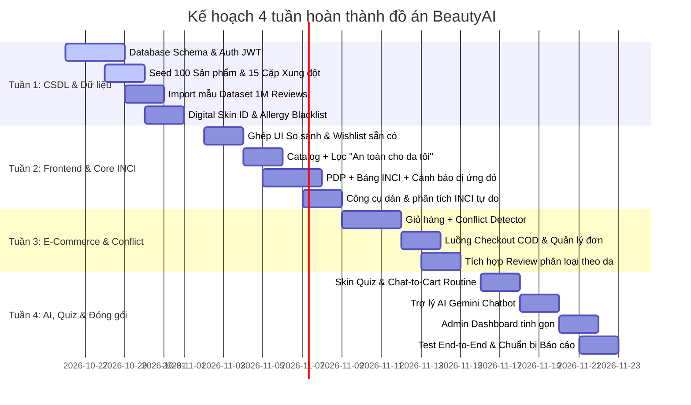

# ĐẶC TẢ PHẠM VI CHỨC NĂNG PHASE 1 (ĐỒ ÁN TỐT NGHIỆP — BEAUTYAI)

> **Mục tiêu:** Hoàn thiện và đóng gói toàn bộ hệ thống BeautyAI trong vòng **1 tháng (4 tuần)** phục vụ bảo vệ đồ án tốt nghiệp.
> **Nguyên tắc phân bổ:** 
> - Ưu tiên tuyệt đối các tính năng USP (Khác biệt hóa & AI da liễu): Digital Skin ID, Allergy Blacklist, INCI Analyzer, Conflict Detector, Skin Quiz, Trợ lý Gemini AI.
> - Khai thác tối đa thế mạnh tài nguyên sẵn có: **Dataset 1 triệu review** (lọc review theo loại da) và **UI có sẵn** (So sánh sản phẩm & Wishlist).
> - Cắt giảm các tính năng quản trị phức tạp, tích hợp bên thứ ba rườm rà (Zalo OA, tỷ giá đa tệ, email SMTP...) để đưa vào **Phase 2 (Hướng phát triển tương lai trong báo cáo)**.

---

## 1. TÀI KHOẢN & XÁC THỰC (AUTHENTICATION & PROFILE)

### 🟢 Phase 1 — Triển khai cho đồ án:
1. **Đăng ký & Đăng nhập:** Xác thực bằng Email/Mật khẩu (sử dụng JWT hoặc Session).
2. **Đăng xuất:** Hủy phiên làm việc an toàn.
3. **Đổi mật khẩu:** Cho phép người dùng đổi mật khẩu khi đã đăng nhập.
4. **Xem & cập nhật thông tin cá nhân:** Họ tên, số điện thoại, ngày sinh, địa chỉ giao hàng mặc định.
5. **Phân quyền truy cập cơ bản (RBAC):** 
   - Khách vãng lai / Người dùng (`CUSTOMER`).
   - Quản trị viên (`ADMIN`).
   - Middleware chặn truy cập trái phép vào các route bảo vệ (`/admin`, `/profile`, `/checkout`).

### 🔴 Phase 2 — Tạm hoãn sang tương lai:
- *Admin đặt lại mật khẩu cho khách qua email token*: Phase 1 Admin chỉ cần có quyền vô hiệu hóa (deactivate) hoặc hỗ trợ set mật khẩu tạm trực tiếp nếu cần test.
- *Đăng nhập bằng mạng xã hội (Google / Facebook OAuth)*: Không làm kịp và dễ lỗi cấu hình redirect URI trên localhost/demo.

---

## 2. DANH MỤC, TÌM KIẾM & SMART FILTER

### 🟢 Phase 1 — Triển khai cho đồ án:
1. **Duyệt danh mục sản phẩm:** Cây danh mục 2-3 cấp (Chăm sóc da -> Làm sạch -> Sữa rửa mặt / Tẩy trang...).
2. **Tìm kiếm sản phẩm:** Tìm theo tên sản phẩm, tên thương hiệu hoặc từ khóa hoạt chất (ví dụ: gõ "Niacinamide").
3. **Lọc theo Loại da & Khoảng giá:** Lọc sản phẩm phù hợp da dầu, khô, nhạy cảm... và thanh trượt khoảng giá (VND).
4. **Sắp xếp kết quả:** Theo giá tăng/giảm, đánh giá sao cao nhất, bán chạy/phổ biến.
5. **Hiển thị & xóa bộ lọc:** Danh sách các chip bộ lọc đang áp dụng, có nút xóa từng filter và "Xóa tất cả".
6. **Lọc riêng "An toàn cho da tôi" *(USP)*:** 
   - Công tắc (toggle switch) dành cho user đã đăng nhập và có Digital Skin ID.
   - Khi bật: Tự động loại bỏ toàn bộ sản phẩm chứa thành phần trong **Allergy Blacklist** của user đó.

### 🔴 Phase 2 — Tạm hoãn sang tương lai:
- *Lọc theo chứng nhận (Vegan / Cruelty-Free / Clean) & Lọc loại trừ "Free-of" chi tiết:* Tốn rất nhiều công chuẩn hóa dữ liệu từng sản phẩm; chỉ đưa vào danh mục thuộc tính mở rộng ở Phase 2.

---

## 3. TRANG CHI TIẾT SẢN PHẨM (PDP) & PHÂN TÍCH INCI

### 🟢 Phase 1 — Triển khai cho đồ án:
1. **Thông tin cơ bản sản phẩm:** Tên, thương hiệu, hình ảnh, giá bán, mô tả, dung tích, tình trạng kho.
2. **Hiển thị bảng thành phần INCI đầy đủ:** Danh sách thành phần chuẩn hóa theo thứ tự nồng độ, có giải nghĩa công năng tiếng Việt (Dưỡng ẩm, Làm dịu, Chống lão hóa, Tẩy da chết...).
3. **Điểm Phù Hợp (Match Score):** Tính toán độ tương thích của sản phẩm với hồ sơ da hiện tại của người dùng (thang điểm % trực quan).
4. **Biểu đồ phân bổ công năng thành phần:** Donut chart hoặc Progress bar hiển thị tỷ lệ các nhóm công năng (ví dụ: 40% Dưỡng ẩm, 20% Chống oxy hóa...).
5. **Cảnh báo dị ứng cá nhân trên PDP *(USP)*:** 
   - Banner màu đỏ nổi bật: *"Cảnh báo: Sản phẩm chứa [Tên chất] nằm trong Danh sách dị ứng của bạn"*.
6. **Thêm vào giỏ từ PDP:** Chọn số lượng và thêm vào giỏ hàng.
7. **Hướng dẫn sử dụng & Vị trí trong routine:** Gợi ý dùng vào buổi Sáng (AM) hay Tối (PM), sau bước nào và trước bước nào.
8. **Sản phẩm tương tự:** Gợi ý tối đa 4-6 sản phẩm cùng danh mục/công dụng.
9. **Thêm vào Wishlist / So sánh từ PDP:** Nút bấm tương tác nhanh kết nối với Modal/Bar so sánh và Danh sách yêu thích.

### 🔴 Phase 2 — Tạm hoãn sang tương lai:
- *"Vì sao sản phẩm này được gợi ý?" (Modal giải thích trọng số thuật toán):* Thay bằng 1 dòng tooltip/text ngắn gọn.
- *"Thường được mua cùng" (Frequently Bought Together):* Cần thuật toán khai phá giỏ hàng (Apriori/Association Rules), tốn tài nguyên tính toán.

---

## 4. DIGITAL SKIN ID & CẢNH BÁO DỊ ỨNG

### 🟢 Phase 1 — Triển khai cho đồ án (USP Cốt lõi):
1. **Tạo & cập nhật hồ sơ da:** 
   - Chọn loại da chính: `Dầu`, `Khô`, `Hỗn hợp`, `Thường`.
   - Chọn thuộc tính bổ sung: Công tắc `Da nhạy cảm`.
   - Chọn các vấn đề da quan tâm (tối đa 5): `Mụn`, `Thâm nám`, `Lỗ chân lông to`, `Lão hóa`, `Khô bong tróc`...
2. **Quản lý Allergy Blacklist (`FR-SKIN-02`):**
   - Ô tìm kiếm có auto-suggest thành phần từ DB (gõ tiếng Việt hoặc tên INCI đều ra).
   - Thêm chất dị ứng vào danh sách cá nhân dưới dạng thẻ xóa được.
3. **Cảnh báo dị ứng xuyên suốt hệ thống:**
   - Cảnh báo xuất hiện tại: Thẻ sản phẩm ngoài danh mục, trang PDP, mục Giỏ hàng, kết quả Skin Quiz và câu trả lời AI Chatbot.
4. **Gợi ý sản phẩm thay thế an toàn:** Link bấm *"Tìm sản phẩm thay thế"* chuyển hướng đến danh mục lọc các sản phẩm cùng nhóm nhưng không chứa chất dị ứng.

### 🔴 Phase 2 — Tạm hoãn sang tương lai:
- *Xem lại lịch sử thay đổi hồ sơ da*: Không cần thiết cho mục đích demo đồ án.
- *Xóa hồ sơ da*: Chỉ cần hỗ trợ cập nhật đè (update) lại thông tin là đủ.
- *Kiểm soát việc chia sẻ hồ sơ với trợ lý AI*: Mặc định gửi thông tin hồ sơ da cho AI để tư vấn tốt nhất.

---

## 5. SKIN QUIZ & ROUTINE BUILDER

### 🟢 Phase 1 — Triển khai cho đồ án (USP Cốt lõi):
1. **Bộ câu hỏi chẩn đoán sơ bộ (4-5 bước):**
   - Câu 1: Cảm giác da sau khi rửa mặt 30 phút? (Xác định loại da).
   - Câu 2: Vấn đề da ưu tiên cải thiện nhất? (Mụn / Sạm / Lão hóa...).
   - Câu 3: Mức độ nhạy cảm của da? (Dễ ửng đỏ / Bình thường).
   - Câu 4: Ngân sách dự kiến cho chu trình dưỡng da?
2. **Tính toán gợi ý theo thuật toán phân tầng:**
   - Lọc danh mục phù hợp -> Khớp loại da -> Trừ điểm tuyệt đối (-1000) với sản phẩm dính Allergy Blacklist -> Chọn sản phẩm tối ưu trong ngân sách.
3. **Hiển thị Routine Builder AM/PM trực quan:**
   - **AM (Buổi sáng):** Làm sạch -> Cân bằng/Đặc trị -> Dưỡng ẩm -> **Chống nắng (Bắt buộc)**.
   - **PM (Buổi tối):** Tẩy trang -> Làm sạch -> Đặc trị -> Dưỡng ẩm.
4. **Giải thích lý do đề xuất:** Nêu rõ tại sao bộ sản phẩm này phù hợp với tình trạng da đã chọn.
5. **Cảnh báo xung đột trong routine:** Kiểm tra xem các bước trong cùng buổi có chứa hoạt chất kỵ nhau hay không.
6. **Chat-to-Cart *(Tính năng Wow)*:** Nút bấm *"Thêm toàn bộ Routine vào giỏ hàng"* (tự động đưa cả 3-5 sản phẩm vào giỏ cùng lúc).
7. **Lưu routine vào hồ sơ:** Lưu lại kết quả để user xem lại trong trang cá nhân mà không cần làm lại quiz.

### 🔴 Phase 2 — Tạm hoãn sang tương lai:
- *Làm lại quiz & so sánh với routine cũ theo dòng thời gian.*
- *Xuất routine ra file PDF / chia sẻ lên mạng xã hội.*

---

## 6. CÔNG CỤ PHÂN TÍCH THÀNH PHẦN (INCI ANALYZER)

### 🟢 Phase 1 — Triển khai cho đồ án:
1. **Dán & phân tích bảng thành phần bất kỳ:** 
   - Một ô Textarea cho phép người dùng copy paste toàn bộ thành phần in trên bao bì của bất kỳ món mỹ phẩm nào họ đang dùng ở nhà.
   - Hệ thống tự động bóc tách (parse) theo dấu phẩy, tra cứu từ điển INCI trong DB.
2. **Kết quả phân tích an toàn:**
   - Đánh dấu màu trực quan: Thành phần an toàn / Dưỡng ẩm (Xanh lá), Hoạt chất mạnh cần chú ý (Vàng/Cam), Thành phần dễ gây kích ứng/cồn khô/hương liệu (Đỏ).
   - Thống kê tỷ lệ độ lành tính và chỉ số bít tắc lỗ chân lông (Comedogenic).
3. **Đối chiếu với hồ sơ da cá nhân:**
   - Phát hiện ngay nếu bảng thành phần vừa dán có chứa chất nằm trong **Allergy Blacklist** của người dùng.

### 🔴 Phase 2 — Tạm hoãn sang tương lai:
- *Từ điển bách khoa tra cứu chi tiết từng chất dạng Wikipedia:* Chỉ cần hiển thị popup/tooltip tóm tắt công năng khi click vào từng chất.

---

## 7. SMART CONFLICT DETECTOR (PHÁT HIỆN XUNG ĐỘT HOẠT CHẤT)

### 🟢 Phase 1 — Triển khai cho đồ án (USP Cốt lõi):
1. **Phát hiện xung đột trong giỏ hàng:**
   - Hệ thống tự động quét các sản phẩm đang có trong giỏ hàng.
   - Nếu giỏ hàng đồng thời có 2 sản phẩm chứa cặp hoạt chất kỵ nhau (Ví dụ: `Retinol` + `AHA/BHA`, `Benzoyl Peroxide` + `Retinoid`...), lập tức kích hoạt cảnh báo.
2. **Hiển thị giải thích & Phương án xử lý cụ thể:**
   - Cảnh báo viền vàng/cam kèm giải thích: *"Sản phẩm A chứa BHA và Sản phẩm B chứa Retinol khi dùng cùng lúc có thể gây kích ứng hoặc bào mòn da"*.
   - Đưa ra hướng xử lý: *"Khuyên dùng: Dùng BHA vào tối thứ 2-4-6, Retinol vào tối thứ 3-5-7"* hoặc *"Chia buổi Sáng/Tối"*.
3. **Không chặn quyền quyết định mua hàng:** Khách hàng vẫn có quyền tick xác nhận *"Tôi đã hiểu cảnh báo"* và tiếp tục thanh toán bình thường.
4. **Phát hiện xung đột trong Routine Builder:** Áp dụng kiểm tra chéo tự động ngay khi sinh ra Routine gợi ý.

### 🔴 Phase 2 — Tạm hoãn sang tương lai:
- *Kiểm tra xung đột với sản phẩm khách đang dùng ở nhà:* Quy trình nhập liệu quá phức tạp cho người dùng trong giai đoạn đầu.
- *Giao diện Admin tạo mới quy tắc xung đột:* **Giải pháp cho Phase 1:** Seed cứng 10-15 bộ quy tắc xung đột khoa học phổ biến nhất vào CSDL hoặc file JSON config.

---

## 8. SO SÁNH SẢN PHẨM (ĐÃ CÓ SẴN UI FRONTEND)

### 🟢 Phase 1 — Triển khai cho đồ án (Khai thác UI có sẵn):
1. **Thêm sản phẩm vào khay so sánh:** Chọn tối đa 3-4 sản phẩm cùng danh mục từ trang Catalog hoặc PDP.
2. **Khay so sánh (Compare Drawer/Bar):** Thanh ghim ở đáy màn hình hiển thị danh sách các món đang chọn, có nút "So sánh ngay" và nút xóa từng món.
3. **Bảng so sánh chi tiết (Side-by-side table):**
   - So sánh thông số cơ bản: Giá bán, dung tích, xuất xứ, thương hiệu, rating.
   - So sánh công năng: Phù hợp loại da nào, giải quyết vấn đề da gì.
   - So sánh thành phần: Điểm giống nhau và khác nhau về hoạt chất chính.
   - So sánh điểm tương thích với hồ sơ da (Match Score của từng món).
4. **Cảnh báo cá nhân hóa trong bảng so sánh:** Đánh dấu cảnh báo đỏ ngay trên cột sản phẩm nào dính chất trong Allergy Blacklist của người dùng.

### 🔴 Phase 2 — Tạm hoãn sang tương lai:
- *Tự động đề xuất sản phẩm đối trọng tương đương để so sánh.*

---

## 9. DANH SÁCH YÊU THÍCH (WISHLIST) (ĐÃ CÓ SẴN UI FRONTEND)

### 🟢 Phase 1 — Triển khai cho đồ án (Khai thác UI có sẵn):
1. **Thêm / Bỏ yêu thích:** Bấm icon trái tim trên thẻ sản phẩm (Catalog) hoặc trang chi tiết (PDP).
2. **Trang danh sách yêu thích (`/wishlist`):** Xem toàn bộ các sản phẩm đã lưu, hiển thị giá hiện tại và tình trạng còn/hết hàng.
3. **Chuyển nhanh vào giỏ hàng:** Nút "Thêm vào giỏ" ngay trên từng thẻ sản phẩm trong trang Wishlist.
4. **Xóa khỏi Wishlist:** Xóa từng sản phẩm hoặc nút "Xóa tất cả".

### 🔴 Phase 2 — Tạm hoãn sang tương lai:
- *Tự động gửi email/thông báo đẩy khi sản phẩm trong Wishlist giảm giá hoặc có hàng trở lại.*

---

## 10. GIỎ HÀNG & THANH TOÁN (CART & CHECKOUT)

### 🟢 Phase 1 — Triển khai cho đồ án:
1. **Xem giỏ hàng:** Trang giỏ hàng chuẩn (`/cart`) hiển thị danh sách sản phẩm, hình ảnh, đơn giá, số lượng, thành tiền.
2. **Thao tác giỏ hàng:** Tăng/giảm số lượng, xóa sản phẩm, dọn sạch giỏ.
3. **Tích hợp cảnh báo xung đột:** Hiển thị khối cảnh báo xung đột hoạt chất nổi bật ngay đầu giỏ hàng (nếu có).
4. **Mã giảm giá (Voucher) cơ bản:** Một ô nhập mã giảm giá áp dụng mã cố định (demo 1-2 mã như `BEAUTYAI10` giảm 10%, `FREESHIP`).
5. **Luồng Checkout:**
   - Form nhập địa chỉ nhận hàng, số điện thoại, ghi chú giao hàng.
   - Phương thức thanh toán: **COD (Thanh toán khi nhận hàng)** là bắt buộc.
   - *Tùy chọn bổ sung:* Tích hợp cổng VNPay Sandbox nếu kịp trong tuần 4.
6. **Tạo đơn hàng & Trang kết quả (Thank You page):** Tạo mã đơn hàng duy nhất, lưu thông tin vào DB và hiển thị tóm tắt đơn vừa đặt.
7. **Lịch sử đơn hàng của tôi:** Người dùng xem lại các đơn hàng đã đặt và trạng thái đơn (`Chờ xử lý`, `Đang giao`, `Đã giao`).

### 🔴 Phase 2 — Tạm hoãn sang tương lai:
- *Cart Drawer trượt ngang:* Dùng trang `/cart` truyền thống để tránh lỗi đồng bộ state phức tạp.
- *Hệ thống Voucher đa tầng (kết hợp voucher sàn + voucher shop + voucher ship).*
- *Khách tự hủy đơn hàng / Mua lại đơn cũ.*
- *Gửi Email xác nhận đơn hàng qua SMTP.*

---

## 11. TRỢ LÝ AI (AI SKINCARE ASSISTANT)

### 🟢 Phase 1 — Triển khai cho đồ án (USP Cốt lõi):
1. **Giao diện Chatbot:** Khung chat dạng widget nổi ở góc màn hình hoặc trang chat riêng biệt (`/chat`).
2. **Kết nối mô hình AI (Google Gemini API):** Sử dụng model Gemini 1.5 Flash / Pro với độ trễ thấp và chi phí tối ưu.
3. **Grounding dữ liệu sản phẩm:** AI được nạp ngữ cảnh danh mục sản phẩm của sàn để khi tư vấn chu trình, AI sẽ giới thiệu chính xác các sản phẩm đang có bán trên web kèm link/hình ảnh.
4. **Cá nhân hóa theo hồ sơ da:** AI tự động đọc Digital Skin ID của người dùng (nếu đã đăng nhập) để chào hỏi và đưa ra lời khuyên tránh các chất dị ứng của họ.
5. **System Prompt kiểm soát an toàn:**
   - Đóng vai trò chuyên viên tư vấn mỹ phẩm.
   - Tuyệt đối không chẩn đoán bệnh da liễu nặng (như chàm, vảy nến, viêm da mủ); khi gặp từ khóa bệnh lý, AI lịch sự khuyên người dùng đến bệnh viện khám chuyên khoa.
   - Ngăn chặn các câu hỏi ngoài phạm vi làm đẹp (Prompt guardrail).

### 🔴 Phase 2 — Tạm hoãn sang tương lai:
- *Kiến trúc phân tầng phức tạp (Tầng 1 rules cứng -> Tầng 2 LLM -> Tầng 3 Zalo).*
- *Chuyển tiếp hội thoại sang Zalo OA (đã thống nhất bỏ).*
- *Lưu và phân tích lịch sử hội thoại nhiều phiên / Đánh giá chất lượng Like-Dislike.*

---

## 12. ĐÁNH GIÁ & NỘI DUNG CỘNG ĐỒNG (KHAI THÁC 1 TRIỆU DATASET)

### 🟢 Phase 1 — Triển khai cho đồ án (Thế mạnh dữ liệu lớn):
1. **Xem danh sách đánh giá trên trang sản phẩm (PDP):**
   - Hiển thị điểm số trung bình (sao 1-5) và biểu đồ phân bổ số lượng đánh giá theo sao.
   - Hiển thị danh sách review thực tế từ tập dữ liệu 1 triệu records.
2. **Lọc đánh giá theo Loại da & Vấn đề da *(Tính năng cực kỳ giá trị)*:**
   - Người dùng có thể lọc: *"Chỉ xem đánh giá từ những người có DA DẦU"* hoặc *"DA NHẠY CẢM"*.
   - Giúp khách hàng xem đúng trải nghiệm của người có cơ địa tương đồng.
3. **"Người có làn da giống bạn nói gì" (Tổng hợp thông minh):**
   - Nếu user đã có Digital Skin ID, trang PDP tự động ưu tiên hiển thị các review của nhóm người dùng có cùng loại da lên đầu trang.
4. **Viết đánh giá cho sản phẩm đã mua:**
   - Form cho phép khách hàng đã mua gửi số sao, nhận xét và tick chọn loại da của mình lúc đánh giá.

### 🔴 Phase 2 — Tạm hoãn sang tương lai:
- *Hệ thống bình chọn đánh giá hữu ích (Upvote/Helpful).*
- *Kiểm duyệt đánh giá bằng AI (phát hiện spam/từ ngữ phản cảm tự động).*

---

## 13. QUẢN TRỊ SÀN (ADMIN DASHBOARD TINH GỌN)

### 🟢 Phase 1 — Triển khai cho đồ án:
1. **Bảng điều khiển tổng quan (Dashboard):** Các thẻ KPI chính: Tổng số sản phẩm, tổng đơn hàng, tổng doanh thu, số lượng người dùng.
2. **Quản lý sản phẩm (Product CRUD):** Thêm mới, chỉnh sửa thông tin sản phẩm, cập nhật giá, hình ảnh, danh mục và nhập chuỗi thành phần INCI.
3. **Quản lý đơn hàng (Order Management):** Xem danh sách đơn hàng mới, đổi trạng thái đơn (`Chờ xử lý` -> `Đang giao hàng` -> `Hoàn thành` / `Hủy đơn`).
4. **Quản lý danh mục & thương hiệu:** CRUD danh mục cấp 1, cấp 2 và danh sách thương hiệu.
5. **Quản lý từ điển thành phần cơ bản:** Xem và thêm mới các thành phần INCI chính kèm phân loại công năng.

### 🔴 Phase 2 — Tạm hoãn sang tương lai:
- *Xuất báo cáo doanh thu ra file Excel.*
- *Quản lý cấu hình tỷ giá USD/VND (Phase 1 chốt toàn bộ hệ thống chạy chuẩn 1 loại tiền tệ là VND).*
- *Nhật ký kiểm toán (Audit log ghi nhận thao tác của admin).*
- *Giao diện xem lại và gắn nhãn các phiên hội thoại AI Chatbot.*

---

## 14. TRANG NỘI DUNG TĨNH & HỖ TRỢ (STATIC CONTENT)

### 🟢 Phase 1 — Triển khai cho đồ án:
1. **Trang FAQ & Hướng dẫn mua hàng:** Các câu hỏi thường gặp về cách tra cứu thành phần, thanh toán và giao hàng.
2. **Trang phương pháp tính Safety Score & Thuật toán đề xuất:** Giải thích ngắn gọn về cách hệ thống tính điểm tương thích da để chứng minh tính khoa học của đồ án.
3. **Trang Chính sách bảo mật & Điều khoản sử dụng:** Nội dung cơ bản khẳng định tôn trọng dữ liệu nhạy cảm (Skin Profile) của người dùng.
4. **Trang 404 & Trang thông báo lỗi thân thiện.**

### 🔴 Phase 2 — Tạm hoãn sang tương lai:
- *Hệ thống chuông thông báo In-App (Notification center).*
- *Hệ thống form gửi vé hỗ trợ (Ticket support).*

---

# KẾ HOẠCH HÀNH ĐỘNG 4 TUẦN (SPRINT ROADMAP)

### Chi tiết phân bổ công việc theo tuần:

- **Tuần 1: Nền tảng Backend, CSDL & Dữ liệu lớn (Data Foundation)**
  - Thiết kế bảng CSDL tinh gọn (bỏ các bảng audit, zalo, currency).
  - Hoàn thành Auth (Đăng ký, Đăng nhập, Profile, Digital Skin ID, Allergy Blacklist).
  - Chuẩn bị dữ liệu: Seed khoảng 50–100 sản phẩm có bảng thành phần INCI đầy đủ; đưa tập mẫu 1 triệu review vào DB (tối ưu index trên cột `product_id` và `skin_type` để query cực nhanh).
- **Tuần 2: Ghép UI có sẵn & Xây dựng các tính năng INCI Cốt lõi**
  - Tích hợp các màn hình UI đã có sẵn từ thư mục frontend: **Bảng So sánh sản phẩm** và **Danh sách Wishlist**.
  - Xây dựng trang Danh mục sản phẩm với bộ lọc theo loại da và công tắc *"An toàn cho da tôi"*.
  - Xây dựng trang chi tiết sản phẩm (PDP): Bảng INCI, biểu đồ công năng, cờ cảnh báo đỏ nếu trùng chất trong Allergy Blacklist.
  - Làm trang Công cụ Dán & Phân tích INCI độc lập.
- **Tuần 3: Giỏ hàng, Phát hiện xung đột, Thanh toán & Review**
  - Làm trang Giỏ hàng và thuật toán **Smart Conflict Detector** (quét cặp kỵ nhau, cảnh báo vàng).
  - Luồng Thanh toán COD -> Tạo đơn -> Lịch sử đơn hàng.
  - Hiển thị danh sách đánh giá tại trang PDP có bộ lọc theo Loại da của người đánh giá (tận dụng dataset).
- **Tuần 4: AI Skincare Assistant, Skin Quiz, Admin & Tổng duyệt**
  - Tích hợp Skin Quiz 4 câu hỏi -> Tạo Routine AM/PM -> Nút bấm **Chat-to-Cart** thêm cả bộ vào giỏ.
  - Tích hợp Chatbot Gemini API tư vấn làm đẹp, cá nhân hóa theo Skin ID và grounding sản phẩm trong shop.
  - Trang Admin: Quản lý sản phẩm và trạng thái đơn hàng.
  - Kiểm thử toàn bộ kịch bản thuyết trình từ đầu đến cuối (Happy Path), chuẩn bị slide và tài liệu báo cáo.
