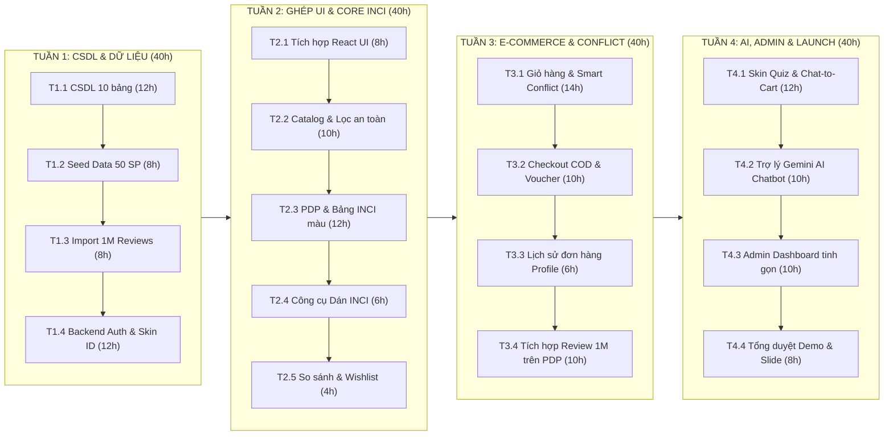

# KẾ HOẠCH CHI TIẾT 30 NGÀY (MASTER PLAN) — BEAUTYAI PHASE 1 (MVP)

> **Mục tiêu:** Bản kế hoạch quản trị dự án chi tiết (Full Comprehensive Master Plan) phân bổ cho **1 Kỹ sư (Solo Developer)** phát triển và đưa vào vận hành hệ sinh thái BeautyAI hoàn chỉnh trong vòng **4 tuần (30 ngày)**, phục vụ launch Production và bảo vệ đồ án tốt nghiệp xuất sắc.
> **Quy mô thời gian:** 160 giờ làm việc chính thức + 20 giờ dự phòng (Buffer).
> **Phân kỳ:** 4 Sprint hàng tuần với các mốc kiểm định chất lượng (Quality Gates) khắt khe.

---

# 1. TỔNG QUAN NGUỒN LỰC & MỤC TIÊU DỰ ÁN

## 1.1. Mục tiêu định lượng cần đạt (Sprint Objectives & KPIs)
1. **Hoàn thiện 100% 5 tính năng USP cốt lõi:**
   - Digital Skin ID & Allergy Blacklist hoạt động trên mọi trang.
   - Smart Conflict Detector quét chính xác 12 cặp hoạt chất kỵ nhau trong giỏ hàng.
   - INCI Analyzer bóc tách văn bản bao bì tự do chính xác.
   - Skin Quiz 4 câu chẩn đoán ➔ Tạo Routine AM/PM ➔ Nút bấm **Chat-to-Cart** thêm cả bộ vào giỏ hàng.
   - Trợ lý AI Gemini tư vấn chuẩn y khoa, grounding 100% sản phẩm có trong sàn.
2. **Hiệu năng & Dữ liệu lớn:**
   - Nạp thành công tập mẫu dataset 1 triệu đánh giá; thời gian truy vấn lọc theo loại da trên trang PDP dưới **50ms**.
3. **Luồng E-Commerce hoàn chỉnh:**
   - Khách vãng lai ➔ Đăng ký tài khoản ➔ Làm Quiz ➔ Duyệt Catalog ➔ Xem PDP ➔ Thêm giỏ hàng cảnh báo xung đột ➔ Đặt hàng COD ➔ Admin duyệt đơn.
4. **Chất lượng mã nguồn:**
   - Toàn bộ 11 bài kiểm thử kiến trúc `BeautyAI.ArchitectureTests` và unit tests XANH 100%.
   - `./syntheprise gate` đạt trạng thái **Clean** (0 lỗi, 0 cảnh báo).

## 1.2. Phân bổ ngân sách thời gian cho Solo Developer
- **Tổng thời lượng:** 30 ngày lịch = 4 tuần làm việc.
- **Định mức:** 40 giờ/tuần (8 giờ/ngày × 5 ngày/tuần).
- **Tổng thời gian phân bổ:** 160 giờ làm việc trực tiếp + 20 giờ dự phòng cuối tuần = **180 giờ**.

---

# 2. BẢN ĐỒ TIẾN ĐỘ TỔNG THỂ (4-WEEK SPRINT ROADMAP)

---

# 3. KẾ HOẠCH PHÂN RÃ CHI TIẾT THEO TUẦN (WORK BREAKDOWN STRUCTURE)

---

## 3.1. SPRINT 1: NỀN TẢNG CSDL, DỮ LIỆU LỚN & XÁC THỰC (40 Giờ)
- **Thời gian:** Ngày 1 đến Ngày 7.
- **Mục tiêu:** Xây dựng xong toàn bộ kiến trúc CSDL PostgreSQL, hoàn thành import dữ liệu lớn và cụm API Auth + Digital Skin ID.

| Mã Task | Tên nhiệm vụ | Thời lượng | Đầu vào kỹ thuật | Đầu ra nghiệm thu |
|---|---|---|---|---|
| **T1.1** | **Khởi tạo Schema CSDL PostgreSQL 17** | 12 giờ | `docs/_tech-solutions/beauty_ai_tech_solutions_phase_1.md` | 10 bảng CSDL tạo thành công qua EF Core Migration hoặc SQL Script; cấu hình khóa ngoại và ràng buộc CHECK. |
| **T1.2** | **Xây dựng bộ Seed Data mỹ phẩm chuẩn** | 8 giờ | Danh mục sản phẩm & 12 quy tắc xung đột | 10 thương hiệu, 50 sản phẩm thực tế có đầy đủ chuỗi thành phần INCI, 150 hoạt chất hóa học, 12 cặp quy tắc xung đột. |
| **T1.3** | **Xử lý & Đánh chỉ mục tập mẫu 1M Reviews** | 8 giờ | File CSV tại `docs/_data/processed/` | Bảng `reviews` nạp đầy đủ dữ liệu mẫu; B-Tree index trên `(product_id, skin_type)` giúp query lọc dưới **50ms**. |
| **T1.4** | **Xây dựng API Auth & Digital Skin ID** | 12 giờ | C# .NET 10 Web API | Đăng ký, Đăng nhập (JWT), Đổi mật khẩu, Cập nhật thông tin, Cập nhật hồ sơ da, Thêm/Xóa Allergy Blacklist. |

🎯 **MỐC QUALITY GATE 1 (Cuối Tuần 1):**
- [ ] Docker PostgreSQL 17 chạy ổn định tại port 5432.
- [ ] 100% API Auth & Skin Profile test qua Swagger/Postman đạt Status 200 OK.
- [ ] `./scripts/test` chạy XANH toàn bộ các bài test kiến trúc.

---

## 3.2. SPRINT 2: GHÉP NỐI GIAO DIỆN REACT & TRÍ TUỆ THÀNH PHẦN INCI (40 Giờ)
- **Thời gian:** Ngày 8 đến Ngày 15.
- **Mục tiêu:** Tích hợp toàn bộ giao diện từ `docs/_ui-ux_design/phase_1/frontend/` vào `src/frontend`, kết nối API duyệt sản phẩm và công cụ bóc tách INCI.

| Mã Task | Tên nhiệm vụ | Thời lượng | Đầu vào kỹ thuật | Đầu ra nghiệm thu |
|---|---|---|---|---|
| **T2.1** | **Ghép nối mã nguồn React Frontend** | 8 giờ | Thư mục `docs/_ui-ux_design/phase_1/frontend/` | Đưa các component, CSS, trang vào `src/frontend`; cấu hình base API URL; chạy `npm run build` thành công. |
| **T2.2** | **Hoàn thiện Trang Catalog & Bộ lọc an toàn** | 10 giờ | `Products.jsx` & API `GET /api/v1/products` | Lọc theo loại da, mức giá; Công tắc toggle *"An toàn cho da tôi"* tự động ẩn toàn bộ sản phẩm dính chất dị ứng. |
| **T2.3** | **Hoàn thiện Trang PDP & Bảng INCI phân màu** | 12 giờ | `ProductDetail.jsx` & API chi tiết SP | Bảng INCI phân màu Xanh/Vàng/Đỏ; Biểu đồ Donut công năng; Match Score %; **Banner đỏ cảnh báo dị ứng cá nhân**. |
| **T2.4** | **Hoàn thiện Công cụ Dán & Phân tích INCI** | 6 giờ | `IngredientAnalyzer.jsx` & API parser | Ô Textarea nhận văn bản dán từ bao bì, tự động bóc tách danh sách chất và đối chiếu dị ứng. |
| **T2.5** | **Ghép nối màn hình So sánh & Wishlist** | 4 giờ | `Compare.jsx`, `Wishlist.jsx` | Khay Compare Drawer đáy màn hình; Bảng so sánh 3 sản phẩm; Danh sách yêu thích thả tim. |

🎯 **MỐC QUALITY GATE 2 (Cuối Tuần 2):**
- [ ] Người dùng xem được danh mục, lọc theo loại da và công tắc an toàn hoạt động chính xác.
- [ ] Trang PDP hiển thị bảng INCI có nhãn tiếng Việt và banner cảnh báo đỏ xuất hiện khi trùng chất dị ứng.
- [ ] Công cụ phân tích thành phần dán chuỗi thô bóc tách chuẩn xác.

---

## 3.3. SPRINT 3: THƯƠNG MẠI ĐIỆN TỬ, PHÁT HIỆN XUNG ĐỘT & REVIEW (40 Giờ)
- **Thời gian:** Ngày 16 đến Ngày 22.
- **Mục tiêu:** Hoàn thiện trọn vẹn luồng mua sắm COD, thuật toán phát hiện xung đột trong giỏ hàng và tích hợp lọc đánh giá 1M reviews.

| Mã Task | Tên nhiệm vụ | Thời lượng | Đầu vào kỹ thuật | Đầu ra nghiệm thu |
|---|---|---|---|---|
| **T3.1** | **Giỏ hàng & Smart Conflict Detector (USP)** | 14 giờ | `Cart.jsx` & `ConflictDetectorService` | Quét tự động giỏ hàng; Khung cảnh báo viền cam nổi bật khi có cặp kỵ nhau (vd: Retinol + BHA); Đưa ra lời khuyên chia lịch sáng/tối; Checkbox xác nhận mua tiếp. |
| **T3.2** | **Thanh toán COD & Quản lý Voucher** | 10 giờ | `Checkout.jsx` & API `POST /api/v1/orders` | Form nhập địa chỉ nhận hàng; Áp dụng mã `BEAUTYAI10` (-10%) và `FREESHIP`; Tạo đơn hàng COD và hiển thị trang cảm ơn Thank You. |
| **T3.3** | **Lịch sử đơn hàng cá nhân** | 6 giờ | `Profile.jsx` & API my-orders | Danh sách các đơn hàng đã đặt, mã đơn, tổng tiền VNĐ, danh sách sản phẩm và trạng thái đơn. |
| **T3.4** | **Tích hợp Reviews 1M trên trang PDP** | 10 giờ | Bảng `reviews` đã đánh chỉ mục B-Tree | Hiển thị điểm sao trung bình; Tab lọc đánh giá theo loại da (*"Xem người có DA DẦU nói gì"*); Ưu tiên bài viết cùng loại da với khách. |

🎯 **MỐC QUALITY GATE 3 (Cuối Tuần 3):**
- [ ] Luồng mua sắm thông suốt từ thêm giỏ hàng ➔ giỏ hàng cảnh báo xung đột ➔ đặt hàng COD thành công.
- [ ] Danh sách review trên PDP lọc theo loại da siêu tốc dưới 50ms nhờ B-Tree index.

---

## 3.4. SPRINT 4: TRỢ LÝ AI, SKIN QUIZ, ADMIN & TỔNG DUYỆT DEMO (40 Giờ)
- **Thời gian:** Ngày 23 đến Ngày 30.
- **Mục tiêu:** Hoàn thiện 2 tính năng "Wow" (Skin Quiz Chat-to-Cart và Gemini AI Chatbot), trang Admin Console và đóng gói kịch bản bảo vệ đồ án.

| Mã Task | Tên nhiệm vụ | Thời lượng | Đầu vào kỹ thuật | Đầu ra nghiệm thu |
|---|---|---|---|---|
| **T4.1** | **Skin Quiz 4 Bước & Nút "Chat-to-Cart"** | 12 giờ | `SkinQuiz.jsx` & Domain Routine Generator | Bài khảo sát 4 câu trực quan; Thuật toán sinh Routine AM/PM; Nút **Chat-to-Cart** thêm cả bộ vào giỏ trong 1 click; Lưu routine vào hồ sơ. |
| **T4.2** | **Tích hợp Trợ lý Da liễu AI (Gemini API)** | 10 giờ | `GeminiSkincareProvider` trong Infrastructure | Khung chat AI; Grounding danh mục sản phẩm của sàn; Cá nhân hóa theo Skin ID; Rào chắn y tế không chẩn đoán bệnh nặng. |
| **T4.3** | **Admin Dashboard tinh gọn** | 10 giờ | `AdminDashboard.jsx` & API Admin | 4 thẻ KPI tổng quan; CRUD sản phẩm & ô nhập chuỗi thành phần INCI; Đổi trạng thái đơn hàng (`Pending` ➔ `Delivering` ➔ `Completed`). |
| **T4.4** | **Tổng duyệt Demo, Slide & Launch PROD** | 8 giờ | Toàn bộ hệ thống | Kiểm tra `./syntheprise gate` Clean; Chạy thử nghiệm kịch bản Happy Path Demo từ A đến Z; Chuẩn bị slide và tài liệu thuyết minh. |

🎯 **MỐC QUALITY GATE 4 (Cuối Tuần 4 — Bàn Giao & Launch):**
- [ ] Toàn bộ hệ sinh thái chạy mượt mà không lỗi.
- [ ] Kịch bản thuyết trình bảo vệ đồ án diễn ra trơn tru từ A đến Z.
- [ ] `./syntheprise gate` và `./scripts/test` XANH 100%.

---

# 4. KẾ HOẠCH QUẢN TRỊ RỦI RO CHI TIẾT (RISK REGISTER CHO SOLO DEV)

| Rủi ro tiềm ẩn | Mức độ | Khả năng xảy ra | Kế hoạch phòng ngừa & Xử lý (Fallback Strategy) |
|---|---|---|---|
| **1. Quá tải thời gian (Solo Dev bị chậm tiến độ)** | Cao | Trung bình | **Phương án:** Ưu tiên tuyệt đối 5 tính năng USP và luồng mua hàng COD. Nếu tuần 3 bị chậm, tính năng Voucher nâng cao và phân trang review phức tạp sẽ được cắt giảm ngay lập tức. |
| **2. Gián đoạn kết nối Gemini API / Hết hạn Quota** | Trung bình | Trung bình | **Phương án:** Cài đặt cơ chế In-memory Cache cho các câu hỏi phổ biến. Nếu API Gemini trả về lỗi (429 Quota Exceeded), hệ thống tự động fallback sang phản hồi mẫu dựa trên bộ quy tắc cứng (Rule-based) mà không làm sập giao diện chat. |
| **3. Hiệu năng truy vấn 1 triệu review bị chậm** | Cao | Thấp | **Phương án:** Đánh chỉ mục kép B-Tree `idx_reviews_product_skin` ngay từ Tuần 1. Nếu trên máy Mac cấu hình thấp chạy Docker bị chậm, giới hạn tập dữ liệu nạp vào khoảng 100.000 reviews đại diện có đầy đủ 4 loại da. |
| **4. Lỗi sai lệch kiểu dữ liệu Frontend - Backend** | Trung bình | Thấp | **Phương án:** Áp dụng hợp đồng [ADR-008](file:///Users/trucuyen/Documents/beauty_ai/docs/adr/ADR-008-openapi-generated-dto.md): DTO frontend được sinh tự động từ OpenAPI qua lệnh `npm run gen:api`. Job CI `openapi-drift` sẽ chặn ngay nếu có bất kỳ sai lệch nào. |
| **5. Vi phạm bất biến kiến trúc INV-01** | Nghiêm trọng | Thấp | **Phương án:** Bài test `NoSafetyScoreAnywhereTests` tự động quét toàn bộ mã nguồn mỗi khi chạy `./scripts/test`, đảm bảo không bao giờ xuất hiện thuộc tính `SafetyScore`. |
