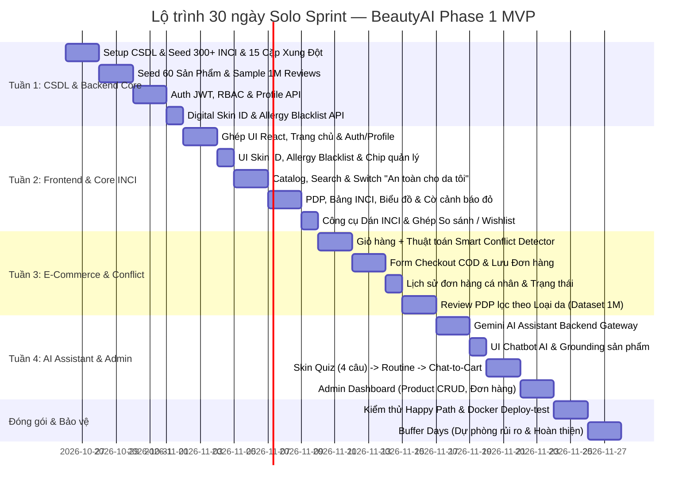

# KẾ HOẠCH TỔNG THỂ & LỘ TRÌNH 30 NGÀY — BEAUTYAI PHASE 1 (MVP)

> **Mô hình thực thi:** Solo Developer (1 Kỹ sư kiêm nhiệm SA/Dev/QA/PM).
> **Thời lượng:** Đúng 30 ngày (4 tuần làm việc + 2 ngày dự phòng).
> **Mục tiêu tối thượng:** Bàn giao sản phẩm MVP hoàn chỉnh, chạy thực tế (PROD / Local Docker), đầy đủ 4 trụ cột USP da liễu và AI, phục vụ bảo vệ đồ án tốt nghiệp xuất sắc.

---

## 1. NGUYÊN TẮC QUẢN TRỊ DỰ ÁN CHO SOLO DEV

1. **Phạm vi bất biến (Scope Lock):** Sau khi kế hoạch này được phê duyệt, **tuyệt đối không nhận thêm tính năng mới**. Mọi ý tưởng phát sinh trong quá trình code đều ghi nhận vào backlog của **Phase 2**.
2. **Ưu tiên giá trị USP:** Tập trung vào các tính năng thể hiện chiều sâu chuyên môn (Digital Skin ID, Allergy Blacklist, Bảng INCI, Smart Conflict Detector, Skin Quiz Chat-to-Cart, Gemini AI Assistant, Dataset Review).
3. **Tận dụng tối đa tài nguyên có sẵn:**
   - Kế thừa và kết nối giao diện React đã hoàn thiện tại `docs/_ui-ux_design/phase_1/`.
   - Sử dụng Docker Compose sẵn có (`postgres:17`).
   - Cắt bỏ các tích hợp bên thứ ba nặng nề (Zalo OA, cổng thanh toán phức tạp, gửi email SMTP).
4. **Quy tắc "Done theo ngày":** Mỗi ngày hoàn thành dứt điểm 1 lát cắt tính năng (Slice) kèm kiểm thử tự động, không để tồn đọng code dở dang qua ngày hôm sau.

---

## 2. BIỂU ĐỒ GANTT TỔNG THỂ 4 TUẦN (SPRINT TIMELINE)

---

## 3. LỘ TRÌNH CHI TIẾT TỪNG NGÀY (DAY-BY-DAY EXECUTION)

### TUẦN 1: CSDL, DỮ LIỆU LỚN & BACKEND FOUNDATION (DAY 1 – DAY 7)
- **Day 1:** 
  - Khởi tạo 10 bảng CSDL PostgreSQL 17 trên Docker (theo thiết kế `beauty_ai_tech_solutions_phase_1.md`).
  - Thiết lập EF Core 10 DbContext và Dapper IDbConnection.
- **Day 2:**
  - Seed từ điển 300+ hoạt chất mỹ phẩm INCI quốc tế (phân loại công năng: Dưỡng ẩm, Làm dịu, Chống lão hóa, Tẩy da chết...).
  - Seed 15 bộ quy tắc xung đột hoạt chất da liễu kinh điển (Retinol + BHA, Benzoyl Peroxide + Retinoid, Vitamin C + AHA...).
- **Day 3:**
  - Seed 50–70 sản phẩm mỹ phẩm có thật trên thị trường Việt Nam (đầy đủ ảnh đẹp, giá bán VND, danh mục, thương hiệu, và chuỗi INCI bóc tách chuẩn).
- **Day 4:**
  - Chuẩn bị dữ liệu đánh giá: Nạp tập mẫu đại diện từ dataset 1 triệu review vào bảng `reviews`.
  - Đánh chỉ mục (Index) trên `(product_id, user_skin_type)` để đảm bảo tốc độ query lọc theo loại da < 30ms.
- **Day 5:**
  - Viết `AuthService` & Controller: Đăng ký, Đăng nhập (cấp JWT Token), Đăng xuất, Đổi mật khẩu, Phân quyền RBAC.
- **Day 6:**
  - Viết `SkinProfileService`: API lưu trữ hồ sơ da (SkinType, Sensitive, Concerns) và API quản lý Allergy Blacklist (tìm kiếm và thêm/xóa chất dị ứng).
- **Day 7 (Milestone 1 — Backend & Data Ready):**
  - Viết Integration Test cho Auth và Skin ID.
  - Kiểm tra toàn bộ API Tuần 1 qua Swagger UI. Xác nhận CSDL và dữ liệu mẫu sẵn sàng 100%.

---

### TUẦN 2: GHÉP UI REACT, CORE INCI & DIGITAL SKIN ID (DAY 8 – DAY 14)
- **Day 8:**
  - Đồng bộ mã nguồn giao diện React từ `docs/_ui-ux_design/phase_1/` vào `src/frontend/`.
  - Cấu hình API Client kết nối mượt mà với Backend .NET (`/api/v1/...`), quản lý token trong AuthContext.
- **Day 9:**
  - Ghép hoàn thiện Trang chủ (Hero banner, USP cam kết khoa học, Top sản phẩm bán chạy).
  - Hoàn thiện Modal / Trang Đăng ký, Đăng nhập, và Trang cá nhân (Profile cá nhân).
- **Day 10:**
  - Hoàn thiện giao diện thiết lập **Digital Skin ID**: Form chọn 4 loại da, công tắc da nhạy cảm, chip chọn tối đa 5 vấn đề da.
  - Ô tìm kiếm và thêm chất dị ứng vào **Allergy Blacklist** dưới dạng thẻ tag xóa được.
- **Day 11:**
  - Xây dựng trang Danh mục sản phẩm (`/products`): Cây danh mục 2 cấp, thanh tìm kiếm từ khóa/hoạt chất, lọc theo loại da và khoảng giá VND.
  - Tích hợp công tắc USP: **"An toàn cho da tôi"** (gọi API lọc tự động loại trừ mọi sản phẩm dính chất trong Allergy Blacklist).
- **Day 12:**
  - Hoàn thiện trang Chi tiết sản phẩm (`/products/:id`): Thông tin cơ bản, giá VND, dung tích.
  - Hiển thị bảng thành phần INCI bóc tách kèm nhãn công năng tiếng Việt.
  - Hiển thị biểu đồ phân bổ công năng và tính toán điểm phù hợp **Match Score (0–100%)**.
  - Hiển thị **Banner cảnh báo đỏ viền đậm** nếu sản phẩm chứa chất trong Allergy Blacklist.
- **Day 13:**
  - Xây dựng trang **Công cụ Dán & Phân tích INCI tự do** (`/ingredient-analyzer`): Textarea copy paste -> Parser -> Kết quả phân màu an toàn (Xanh/Vàng/Đỏ) và đối chiếu Skin Profile.
- **Day 14 (Milestone 2 — Skin Intelligence UI Ready):**
  - Kết nối tính năng So sánh sản phẩm (Compare Drawer đáy màn hình + Bảng so sánh 3 món) và Danh sách yêu thích (Wishlist) từ UI có sẵn.
  - Kiểm thử nghiệm thu Tuần 2: Khách hàng lướt web, thấy cảnh báo dị ứng đỏ và xem phân tích thành phần mượt mà.

---

### TUẦN 3: GIỎ HÀNG, XUNG ĐỘT HOẠT CHẤT & ĐƠN HÀNG COD (DAY 15 – DAY 21)
- **Day 15:**
  - Xây dựng trang Giỏ hàng (`/cart`): Tăng giảm số lượng, xóa sản phẩm, tính tổng tiền.
  - Tích hợp thuật toán **Smart Conflict Detector**: Backend rà soát các cặp kỵ nhau -> Frontend hiển thị Hộp cảnh báo màu vàng/cam nổi bật ngay đầu giỏ hàng kèm lời khuyên giãn cữ AM/PM khoa học.
- **Day 16:**
  - Xây dựng trang Checkout COD (`/checkout`): Form thông tin người nhận (Họ tên, SĐT, Địa chỉ chi tiết, Ghi chú), tự động điền từ Profile.
  - Ô nhập Coupon Code giảm giá đơn giản (demo mã `BEAUTYAI10`, `FREESHIP`).
- **Day 17:**
  - Backend xử lý tạo đơn hàng (`orders` & `order_items`), sinh mã đơn duy nhất `ORD-YYYYMMDD-XXXX`.
  - Hiển thị trang Xác nhận đơn hàng (Thank You page) kèm thông tin tóm tắt và hướng dẫn nhận hàng COD.
- **Day 18:**
  - Xây dựng mục "Lịch sử đơn hàng của tôi" trong trang Profile: Xem danh sách các đơn đã đặt, trạng thái đơn (`Chờ xử lý`, `Đang giao`, `Đã giao`).
- **Day 19:**
  - Tích hợp khu vực Đánh giá khách hàng trên trang PDP: Hiển thị điểm số trung bình (sao 1–5), biểu đồ tỷ lệ sao.
  - Triển khai tính năng USP: **Bộ lọc review theo Loại da** (Lọc chỉ xem review từ người Da dầu / Da nhạy cảm...) khai thác dataset 1 triệu records.
  - Tự động ưu tiên review của người có cùng loại da lên đầu danh sách.
- **Day 20:**
  - Form viết review cho sản phẩm đã mua: Chọn số sao, viết nhận xét, chọn loại da lúc đánh giá.
- **Day 21 (Milestone 3 — Full E-Commerce Flow Ready):**
  - Kiểm thử End-to-End toàn bộ luồng mua hàng: Đăng ký -> Chọn sản phẩm -> Cảnh báo dị ứng -> Giỏ hàng -> Cảnh báo xung đột hoạt chất -> Checkout COD -> Đặt hàng thành công.

---

### TUẦN 4: GEMINI AI, SKIN QUIZ, ADMIN DASHBOARD & TỔNG DUYỆT (DAY 22 – DAY 28)
- **Day 22:**
  - Backend tích hợp Google Gemini API: Service `GeminiChatService`, cấu hình System Prompt y khoa, nạp danh mục 30 sản phẩm làm grounding.
- **Day 23:**
  - Ghép giao diện Trợ lý AI: Widget chat nổi ở góc màn hình và trang `/expert-consult`.
  - Tự động nạp context Digital Skin ID và Allergy Blacklist vào câu hỏi chat. Kiểm tra Guardrail an toàn y khoa.
- **Day 24:**
  - Xây dựng tính năng **Skin Quiz** 4 câu hỏi chẩn đoán da -> Routine Builder trực quan (AM/PM).
  - Tích hợp tính năng Wow: **Chat-to-Cart** (Nút "Thêm cả Routine vào giỏ" đưa 4-5 sản phẩm vào giỏ hàng cùng lúc). Tự động lưu routine vào Profile.
- **Day 25:**
  - Xây dựng trang Admin Dashboard (`/admin`): 4 thẻ KPI doanh thu & sản phẩm.
  - Quản lý sản phẩm (Product CRUD: thêm ảnh, giá, paste chuỗi INCI để hệ thống tự bóc tách).
  - Quản lý đơn hàng: Xem chi tiết đơn COD, nút chuyển trạng thái sang `SHIPPING` và `DELIVERED`.
- **Day 26:**
  - Tối ưu hiệu năng, bảo mật: Rà soát kiểm tra băm mật khẩu, phân quyền route bảo vệ.
  - Đóng gói toàn bộ hệ thống bằng Docker Compose cục bộ ([ADR-013](file:///Users/trucuyen/Documents/beauty_ai/docs/adr/ADR-013-local-mac-test-deployment.md)): chạy script `./scripts/deploy-test` thành công.
- **Day 27:**
  - Chạy toàn bộ test suites (`scripts/test`), kiểm tra Quality Gate (`syntheprise gate`).
  - Diễn tập chạy thử kịch bản thuyết trình bảo vệ đồ án (Happy Path) 15 phút từ đầu đến cuối.
- **Day 28 (Milestone 4 — Final Acceptance & Handover):**
  - Soạn thảo Slide thuyết trình và hoàn thiện tài liệu báo cáo đồ án.
  - Gắn tag release `v1.0.0-phase1-mvp` trên Git repository.

---

### NGÀY DỰ PHÒNG & XỬ LÝ RỦI RO (DAY 29 – DAY 30)
- **Day 29:** Dành riêng để sửa các lỗi hiển thị UI phát sinh (CSS responsive, độ tương phản màu, căn chỉnh khoảng cách trên màn hình nhỏ).
- **Day 30:** Đóng băng toàn bộ mã nguồn (Code Freeze). Chuẩn bị sẵn 1 bản sao lưu CSDL (PostgreSQL dump) để sẵn sàng phục hồi ngay lập tức nếu máy demo gặp sự cố.

---

## 4. MA TRẬN QUẢN TRỊ RỦI RO CHO SOLO DEVELOPER (RISK REGISTER)

| Mã rủi ro | Mô tả rủi ro | Mức độ | Kế hoạch phòng ngừa & Xử lý (Fallback Plan) |
|---|---|---|---|
| **R-01** | Bị nghẽn thời gian ở phần Frontend (viết CSS từ đầu) | **CAO** | **Tuyệt đối không viết CSS từ đầu:** Tận dụng 100% các component và styles có sẵn trong thư mục `docs/_ui-ux_design/phase_1/`. |
| **R-02** | Gemini API bị chạm giới hạn Rate Limit (429) khi demo | **TRUNG BÌNH** | Backend áp dụng In-Memory Cache cho các câu hỏi phổ biến; chuẩn bị sẵn 1 API Key dự phòng trong `.env`. |
| **R-03** | Import tập dữ liệu 1 triệu review làm treo CSDL PostgreSQL | **CAO** | Không import toàn bộ 1 triệu bản ghi ngay ngày đầu: Chỉ trích xuất tập mẫu 10.000–50.000 review thực tế của các sản phẩm có trong sàn, đánh index chuẩn trên `(product_id, user_skin_type)`. |
| **R-04** | Cổng thanh toán trực tuyến bị lỗi cấu hình hoặc chặn IP | **TRUNG BÌNH** | Chốt **COD là phương thức thanh toán chính thức của Phase 1** (vừa thực tế với thị trường mỹ phẩm Việt Nam, vừa không phụ thuộc vào webhook ngân hàng). |
| **R-05** | Máy tính cá nhân gặp sự cố phần cứng trước ngày demo | **THẤP** | Toàn bộ code được push liên tục hàng ngày lên [GitHub keplertuyen/beauty_ai](https://github.com/keplertuyen/beauty_ai); CSDL có script seed tự động chạy trong Docker. |
