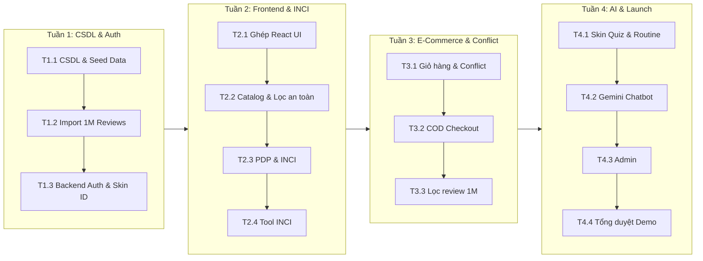

# KẾ HOẠCH THỰC HIỆN 30 NGÀY (MASTER PLAN) — BEAUTYAI PHASE 1 (MVP)

> **Mục tiêu:** Bản kế hoạch hành động chi tiết 4 tuần (30 ngày) cho **1 Kỹ sư (Solo Developer)** phát triển và đưa vào vận hành hệ thống BeautyAI hoàn chỉnh, sẵn sàng bảo vệ đồ án tốt nghiệp xuất sắc và launch Production.

---

## 1. Bản Đồ Tiến Độ Tổng Thể (Roadmap)

---

## 2. Kế Hoạch Chi Tiết 4 Sprint (4 Tuần)

### 🟢 TUẦN 1: Nền Tảng CSDL, Dữ Liệu Lớn & Xác Thực (Data & Auth Foundation)
- **Mục tiêu tuần:** Xây dựng xong nền móng dữ liệu, nạp tập 1 triệu reviews và hoàn thành toàn bộ API tài khoản & hồ sơ da.
- **Các nhiệm vụ:**
  1. **Nhiệm vụ 1.1:** Khởi tạo PostgreSQL Schema 10 bảng cốt lõi; Viết script Seed dữ liệu 50 sản phẩm mỹ phẩm đa dạng danh mục + từ điển 150 thành phần INCI + 12 cặp quy tắc xung đột hoạt chất.
  2. **Nhiệm vụ 1.2:** Xử lý và import tập mẫu dataset 1 triệu đánh giá vào bảng `reviews`; Đánh chỉ mục kép B-Tree trên `(product_id, skin_type)` đảm bảo truy vấn dưới 50ms.
  3. **Nhiệm vụ 1.3:** Xây dựng API .NET 10 cho Auth (Đăng ký, Đăng nhập, Profile) và Digital Skin ID (chọn loại da, vấn đề da, thêm/xóa Allergy Blacklist).
- **Quality Gate Tuần 1:** Các API Auth & Skin Profile test qua Swagger/Postman đạt 100% xanh; CSDL nạp dữ liệu thành công.

---

### 🟢 TUẦN 2: Ghép UI Có Sẵn & Trí Tuệ Thành Phần INCI (Frontend & INCI Core)
- **Mục tiêu tuần:** Đưa giao diện React từ `docs/_ui-ux_design/phase_1/frontend/` vào hệ thống, hoàn thành các màn hình duyệt sản phẩm và công cụ bóc tách thành phần.
- **Các nhiệm vụ:**
  1. **Nhiệm vụ 2.1:** Cấu hình Frontend React 19 + Vite kết nối tới Backend API; Tích hợp hệ thống quản lý state `AppContext`.
  2. **Nhiệm vụ 2.2:** Hoàn thiện trang Catalog (`/products`): Bộ lọc loại da, mức giá, sắp xếp và công tắc *"An toàn cho da tôi"* (tự động ẩn sản phẩm dính chất dị ứng).
  3. **Nhiệm vụ 2.3:** Hoàn thiện trang chi tiết sản phẩm PDP (`/products/:slug`): Bảng INCI có màu, biểu đồ công năng, Match Score %, banner đỏ cảnh báo dị ứng.
  4. **Nhiệm vụ 2.4:** Hoàn thiện công cụ Dán & Phân tích INCI tự do (`/ingredient-analyzer`): Bóc tách text bao bì, tra cứu từ điển và đối chiếu dị ứng.
  5. **Nhiệm vụ 2.5:** Ghép nối khay và bảng So sánh sản phẩm (`/compare`) + Trang Yêu thích (`/wishlist`).
- **Quality Gate Tuần 2:** Người dùng xem được sản phẩm, thấy rõ cảnh báo dị ứng đỏ nếu trùng chất trong Blacklist, chạy thử phân tích INCI bất kỳ cho kết quả chính xác.

---

### 🟢 TUẦN 3: Thương Mại Điện Tử & Phát Hiện Xung Đột (E-Commerce & Conflict)
- **Mục tiêu tuần:** Xây dựng trọn vẹn luồng mua hàng và thuật toán phát hiện xung đột hoạt chất trong giỏ hàng.
- **Các nhiệm vụ:**
  1. **Nhiệm vụ 3.1:** Hoàn thiện Giỏ hàng (`/cart`) và thuật toán **Smart Conflict Detector**: Quét tự động các sản phẩm trong giỏ, kích hoạt cảnh báo viền cam kèm giải thích khoa học và đề xuất chia lịch sáng/tối hoặc cách ngày.
  2. **Nhiệm vụ 3.2:** Luồng Thanh toán COD (`/checkout`): Nhập địa chỉ, áp dụng voucher giảm giá (`BEAUTYAI10`, `FREESHIP`), tạo đơn hàng thành công, hiển thị trang Thank You.
  3. **Nhiệm vụ 3.3:** Trang cá nhân (`/profile`): Hiển thị lịch sử các đơn hàng đã đặt và trạng thái xử lý.
  4. **Nhiệm vụ 3.4:** Tích hợp hiển thị danh sách đánh giá tại trang PDP: Bộ lọc *"Người có cùng loại da nói gì"*, khai thác triệt để dataset 1 triệu review.
- **Quality Gate Tuần 3:** Mua hàng thử nghiệm thành công từ Catalog ➔ Giỏ hàng phát hiện xung đột ➔ Đặt hàng COD ➔ Kiểm tra đơn hàng trong CSDL.

---

### 🟢 TUẦN 4: Trợ Lý AI, Skin Quiz, Admin & Đóng Gói Bàn Giao (AI, Admin & Launch)
- **Mục tiêu tuần:** Hoàn thành các tính năng "Wow" (Skin Quiz, AI Chatbot), giao diện Admin quản lý và đóng gói kịch bản bảo vệ đồ án.
- **Các nhiệm vụ:**
  1. **Nhiệm vụ 4.1:** Hoàn thiện Skin Quiz 4 câu hỏi (`/skin-quiz`) ➔ Thuật toán sinh chu trình Routine AM/PM ➔ Nút **Chat-to-Cart** thêm cả chu trình vào giỏ chỉ với 1 click.
  2. **Nhiệm vụ 4.2:** Tích hợp Trợ lý AI Gemini (`/chat` hoặc floating widget): Nạp ngữ cảnh danh mục sản phẩm sàn (Grounding), đọc hồ sơ da và áp dụng guardrail an toàn da liễu.
  3. **Nhiệm vụ 4.3:** Hoàn thiện Admin Dashboard (`/admin`): Thẻ KPI tổng quan, CRUD sản phẩm & bảng INCI, cập nhật trạng thái đơn hàng (`Chờ xử lý` ➔ `Đang giao` ➔ `Hoàn thành`).
  4. **Nhiệm vụ 4.4:** Trang nội dung tĩnh (FAQ, Phương pháp tính Match Score, Chính sách bảo mật, 404).
  5. **Nhiệm vụ 4.5:** Chạy kịch bản tổng duyệt End-to-End (Happy Path), kiểm tra Quality Gate (`./syntheprise gate` Clean), đóng gói Docker Compose và chuẩn bị slide/kịch bản demo.
- **Quality Gate Tuần 4:** Hệ thống vận hành hoàn hảo, không có lỗi nghiêm trọng, toàn bộ bài test xanh, sẵn sàng bảo vệ đồ án.

---

## 3. Kế Hoạch Quản Lý Rủi Ro Cho Solo Developer (Risk Mitigation)

| Rủi ro tiềm ẩn | Mức độ | Phương án phòng ngừa & Xử lý (Fallback) |
|---|---|---|
| **Vượt hạn mức Gemini API (Quota Limit)** | Trung bình | Cấu hình cơ chế cache phản hồi câu hỏi thường gặp; nếu API gián đoạn, fallback về bộ kịch bản tư vấn rule-based mẫu. |
| **Quá tải khi import 1 triệu review** | Thấp | Viết script import theo batch 1.000 records với `COPY` command của PostgreSQL; nếu máy yếu, có thể dùng tập con 100.000 reviews chọn lọc có đủ phân bổ loại da. |
| **Thiếu thời gian làm thanh toán online** | Cao | Đã chốt phương án cắt bỏ hoàn toàn cổng thanh toán phức tạp, chỉ làm duy nhất **COD**, đảm bảo 100% không bị tắc luồng checkout. |
| **Xung đột thời gian giữa Frontend và Backend** | Trung bình | Tận dụng hợp đồng [ADR-008](file:///Users/trucuyen/Documents/beauty_ai/docs/adr/ADR-008-openapi-generated-dto.md): DTO frontend sinh tự động từ OpenAPI, loại bỏ hoàn toàn lỗi gõ sai tên trường giữa 2 bên. |
