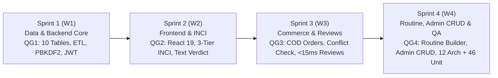

# CHAPTER 1: INTRODUCTION

## 1.1 Background and Context

The global retail sector has experienced a profound digital transformation over the past decade, with cosmetic and personal care products emerging as one of the fastest-growing categories in electronic commerce. In Vietnam, consumer expenditure on beauty and personal care across major e-commerce platforms approached USD 3 billion in 2025, demonstrating an annual growth rate of approximately 30%. Market consolidation has increasingly favoured official brand flagships, which account for nearly two-thirds of total category turnover. This empirical distribution indicates that modern digital consumers prioritise institutional trust, authenticity, and product suitability over aggressive price discounting.

Simultaneously, a structural paradigm shift has emerged within consumer purchasing behaviour. The contemporary consumer base is no longer swayed solely by conventional brand prestige or superficial marketing narratives. Instead, an educated demographic of "skintellectuals" actively investigates cosmetic chemistry, scrutinising formulations, active concentrations, and physiological compatibility before committing to a purchase. Despite this heightened consumer awareness, a critical information asymmetry persists within online retail. Packaging labels present the International Nomenclature of Cosmetic Ingredients (INCI) as dense, unstandardised technical strings that are virtually indecipherable to non-specialists. Consumers face substantial risks of purchasing products containing personal allergens, combining incompatible active chemicals, or relying on crowd-sourced star ratings written by reviewers with diametrically opposed biological skin types.

In parallel, software engineering practices are undergoing a monumental transition driven by agentic artificial intelligence. The integration of autonomous AI coding agents into Integrated Development Environments (IDEs) promises substantial productivity multipliers. However, in the absence of rigorous architectural governance, rapid automated code generation frequently leads to architectural drift, hallucinated dependencies, and catastrophic degradation of domain constraints. This project addresses the intersection of these two domains: delivering an ingredient-aware e-commerce platform grounded in dermatological science, constructed through an empirical, specification-driven software development lifecycle (SDLC) tailored for human-agent collaboration.

---

## 1.2 Problem Statement

The motivation for the BeautyAI platform stems from four acute user-facing dilemmas and a concurrent software engineering challenge:

- **Pervasive Ingredient Illegibility:** Traditional storefronts treat INCI disclosures as passive legal disclaimers rather than interactive functional data. Consumers cannot readily evaluate active percentages, functional roles (e.g., humectants, barrier lipids, synthetic fragrances), or comedogenic thresholds.
- **Systemic Allergy Hazards:** E-commerce architectures lack systemic cross-checking against personal dermatological contraindications. A consumer with an established allergy to specific preservatives, synthetic perfumes, or denatured alcohol must manually cross-reference 40-line chemical disclosures on every product detail page.
- **Severe Active-Ingredient Clashes:** The unguided layering of potent dermatological actives—such as concurrently applying unbuffered Alpha/Beta Hydroxy Acids with high-strength Retinoids, or combining Benzoyl Peroxide with free-form Tretinoin—frequently induces epidermal barrier destruction and severe irritant contact dermatitis. Existing shopping carts process these combinations without cautionary scheduling or biological warnings.
- **The "Safety Score" Fallacy in Existing Tooling:** Commercial scanning utilities (such as Yuka, Think Dirty, or EWG Skin Deep) attempt to address ingredient anxiety by assigning a single, universal numerical "hazard" or "safety" score. Cosmetic scientists comprehensively reject this methodology as scientifically flawed and alarmist. Grounded in the classical pharmacological axiom of Paracelsus (*dosis sola facit venenum*), an ingredient's safety cannot be evaluated in isolation from its formulation matrix, delivery vehicle, exposure concentration, and individual user pathology. Universal hazard scores create unjustified brand disparagement and induce unwarranted consumer anxiety.

From an engineering perspective, the challenge required designing, implementing, and verifying an enterprise-grade, high-performance platform within a compressed four-week timeframe. Achieving this as a Solo Developer demanded an SDLC that could orchestrate autonomous AI coding agents without sacrificing architectural boundaries, relational integrity, or automated quality assurance.

---

## 1.3 Aims and Objectives

### Project Aim
The primary aim of this project is to design, operationalise, and critically evaluate an **AI-Agent Document-Driven Software Development Lifecycle (SDLC)** by implementing and delivering a production-ready Phase 1 Minimum Viable Product (MVP) of **BeautyAI**—an intelligent, ingredient-aware cosmetics e-commerce platform featuring a personalised skincare assistant.

### SMART Objectives
To fulfil this aim, six specific, measurable, achievable, realistic, and time-bound (SMART) objectives were established:

**Table 1.1: SMART Project Objectives and Measurable Success Criteria**

| Objective ID | Objective Description | Target Success Criteria & Verification Mechanism |
|---|---|---|
| **O1** | Formulate the AI-Agent SDLC Model | Define an eight-stage lifecycle (a–h) detailing explicit inputs, outputs, human-agent RACI governance, and quality check gates. Verified by formal process documentation in Chapter 3. |
| **O2** | Construct the Governed Document Hierarchy | Establish a seven-level constitutional precedence ladder spanning BRD, PRD, Technical Solutions, Master Plan, and Playbook. Verified through complete traceability linking business rules to code. |
| **O3** | Engineer the Phase 1 Core E-Commerce MVP | Implement 13 functional modules covering catalog search, 3-tier INCI inspection, Digital Skin ID, Smart Conflict Detection, AM/PM Routine Generation with 1-Click Routine-to-Cart, COD Checkout, and Admin Console. Verified against 8,494 products and 1.09M reviews. |
| **O4** | Automate Architectural & Domain Quality Gates | Machine-enforce Clean Architecture and domain invariants (specifically INV-01 prohibiting universal safety scores) via automated test suites. Verified by achieving **12/12 Architecture Tests** and **46/46 Unit Tests** passing (100% green). |
| **O5** | Maintain Continuous Traceability & Synchronisation | Ensure zero specification drift between code, documentation, and external AI agents using State Snapshots and isolated Git worktrees. Verified by clean execution of `./syntheprise gate` and CI workflows. |
| **O6** | Execute Critical Empirical Evaluation | Benchmark database query latency under big-data loads, validate LLM grounding boundaries, and critically evaluate the software lifecycle. Verified by measurable profiling metrics and defect post-mortems. |

---

## 1.4 Project Scope and Boundaries

To ensure strict delivery within the academic schedule while preserving architectural integrity, the project enacted a clear operational boundary between **Phase 1 (MVP)** and **Phase 2 (Future Roadmap)**:

**Table 1.2: Phase 1 In-Scope Deliverables vs. Phase 2 Deferred Capabilities**

| Functional Area | In-Scope Phase 1 Deliverables (Production-Ready MVP) | Deferred Phase 2 Scope (Strategic Roadmap) |
|---|---|---|
| **Linguistic & Monetary System** | Standardised 100% English user interface and United States Dollar (USD `$`) currency, aligned natively with the global Sephora dataset. | Vietnamese localisation (i18n), dynamic dual-currency toggles (VND/USD), and historical exchange-rate tracking. |
| **Catalog & Product Intelligence** | Multi-level category hierarchy, keyword/active ingredient search, skin-type filters, price slider, and the *"Safe For My Skin"* zero-allergen filter. | Certification badges (Vegan, Cruelty-Free, Clean) and complex boolean exclusion filters ("Free-of"). |
| **Product Detail & INCI Intelligence** | Three-tier progressive disclosure INCI layout, text-based `Suitability Verdict`, red allergy alert banner, and 1.09M review filtering by skin type. | Interactive algorithm-weight breakdown modal and precomputed Apriori cross-sell associations ("Frequently Bought Together"). |
| **Skin Identity & Personalisation** | 30-second unified Digital Skin ID (skin type, sensitivity, concerns, goals, budget) and personal Allergy Blacklist. | Longitudinal skin condition tracking over time and camera-based computer-vision skin diagnostic imaging. |
| **Active Conflict Engine** | Smart Conflict Detector evaluating 12 curated dermatological rules across shopping carts and routines, providing non-blocking scheduling advice. | Administrative conflict rule builder GUI and customer scanning of products currently owned at home. |
| **Routine Construction** | Automatic AM/PM Routine Generator, strict allergen filtering, mandatory morning SPF enforcement, and 1-Click *"Chat-to-Cart"*. | Multi-step interactive skin diagnostic quiz, routine PDF compilation, and social sharing workflows. |
| **External AI Chatbot** | *Architectural seam & safety policy prepared (`IAiSkincareProvider`, `ADR-005`, `docs/llm-policy.md`) for clean future extensibility.* | **Deferred to Phase 2:** Conversational LLM skincare chatbot (`Lumi`), multi-turn RAG grounding, medical safety evaluation, and Zalo Official Account specialist handoff (deferred to prioritise deterministic clinical accuracy within the 4-week schedule). |
| **Commerce & Administration** | Persistent shopping cart, Cash on Delivery (COD) order placement, order history, and full Admin Console Product CRUD with Soft Delete (`Discontinued`) & Restore. | Multi-tier promotional vouchers, integrated payment gateways (VNPay), and automated transactional emails. |

---

## 1.5 Project Plan and Execution Timeline

The implementation was executed across four intensive weekly sprints spanning 28 calendar days (160 scheduled development hours plus a 20-hour contingency buffer). Development proceeded strictly within an isolated local infrastructure driven by Docker Compose and the Syntheprise Framework:

- **Sprint 1 (Days 1–7) — Data Engine, Schema Architecture, and Core Security:** Provisioned the 10-table physical schema on PostgreSQL 17. Executed automated ETL pipelines to seed 8,494 Sephora products, parse INCI nomenclature, populate 12 active conflict rules, and stream 1.09 million customer reviews into indexed tables. Implemented PBKDF2 cryptographic hashing (600,000 iterations), JWT authentication, and the unified Digital Skin ID domain entity.
- **Sprint 2 (Days 8–15) — Frontend Integration and Core INCI Intelligence:** Integrated the React 19 single-page application. Implemented the catalog query engine and the *"Safe For My Skin"* allergen exclusion toggle. Delivered the Product Detail Page (PDP) featuring the 3-Tier INCI progressive disclosure mechanism, deterministic Suitability Verdicts, and the standalone INCI Analyzer with category-aware target care area resolution.
- **Sprint 3 (Days 16–22) — Commerce Pipelines, Active Conflicts, and Big Data Reviews:** Developed the persistent cart engine and the pairwise Smart Conflict Detector. Integrated checkout supporting atomic Cash on Delivery (COD) order placement and user order history. Optimised review pagination queries across 1.09 million records via composite B-Tree indexes, enabling instant review filtering by author skin type.
- **Sprint 4 (Days 23–28) — Routine Automation, Admin Console CRUD, and Final Verification:** Engineered the AM/PM Routine Generator with 1-Click Routine-to-Cart functionality and `saved_routines` persistence. Delivered the comprehensive 3-tab Admin Console supporting real-time database analytics and complete Product CRUD with soft delete (`Discontinued`) and one-click restoration. Formally scoped the conversational LLM chatbot (`M12`) to Phase 2 while preserving the `IAiSkincareProvider` Clean Architecture seam.

*Figure 1.1: Four-Week Sprint Schedule and Milestone Quality Gates.*

---

## 1.6 Summary of Project Outcomes

Upon conclusion of the Phase 1 lifecycle, the project delivered three tangible, production-grade assets:

1. **An Empirical, Governed AI-Agent SDLC:** A fully documented, reusable software engineering methodology defining human-agent responsibilities across eight lifecycle stages. The framework demonstrates that by enforcing a strict document precedence hierarchy and machine-checking domain invariants, a solo developer can harness AI coding agents at scale without succumbing to architectural drift.
2. **A Production-Grade Technical Specification Chain:** A synchronised, 26-document engineering archive comprising formal Business Requirements (BRD), Product Specifications (PRD), 14 Architecture Decision Records (ADRs), database contracts, API definitions, security runbooks, and atomic state snapshots tracking every code modification.
3. **The Fully Operational BeautyAI Platform:** A robust, high-performance web application consisting of a `.NET 10` Clean Architecture backend (**28 core Phase 1 RESTful API endpoints across 8 active controllers**, plus the Phase 2 `IAiSkincareProvider` architectural seam), a `React 19` / TypeScript / Vite frontend, and a containerised `PostgreSQL 17` database. The platform operates over **8,494 authentic Sephora products**, **1.09 million reviews**, and **378+ verified high-resolution WebP images**. Quality is guaranteed by **12/12 Architecture Tests** and **46/46 Unit Tests** passing (100% green), zero compiler warnings, and clean static verification under `./syntheprise gate`.

---

## 1.7 Overview of the Report

The remainder of this report is structured in strict accordance with the University of Greenwich undergraduate engineering standards:

- **Chapter 2 (Literature Review):** Critically examines the theoretical and empirical foundations of cosmetics e-commerce, critiques universal hazard scores, evaluates recommender algorithms and active conflict evidence, analyses LLM grounding techniques, assesses AI coding agents, and contextualises Vietnamese legal compliance.
- **Chapter 3 (Software Development Methodologies & The Proposed SDLC):** Evaluates traditional development models (Waterfall, Spiral, RAD, Agile), details the proposed eight-stage AI-Agent Document-Driven SDLC, and formalises governance mechanisms including the 7-level precedence ladder, system invariants, and the human-agent RACI matrix.
- **Chapter 4 (Technology and Tools):** Justifies the chosen engineering stack (`.NET 10`, `PostgreSQL 17`, `React 19`, `Google Gemini 2.5 Flash`, `NetArchTest`, `Docker Compose`) and outlines the rationale behind the 14 Architecture Decision Records (`ADR-001` to `ADR-014`).
- **Chapter 5 (Software Product Requirements):** Benchmarks existing market competitors, formalises business goals and user personas, models functional requirements (`M01`–`M15`) through Given/When/Then acceptance criteria, and specifies the system use cases, database ERD, and streamlined sitemap.
- **Chapter 6 (Design and Implementation of the Product):** Details the Clean Architecture layer implementations, the deterministic Suitability Verdict cascade, the Smart Conflict Detector, Gemini catalog grounding, the `CHANGE-ANALYZER-CATEGORY` refactoring case study, and core code implementations.
- **Chapter 7 (Evaluation and Results):** Compares outcomes against initial objectives `O1`–`O6`, presents automated testing metrics (12 Architecture Tests, 46 Unit Tests), details big-data query optimisation benchmarks (reducing catalog latency from `33,584 ms` to `80 ms`), and critically examines active conflict nuances and project limitations.
- **Chapter 8 (Conclusions and Further Development):** Reflects upon personal engineering and ethical learnings, summarises core academic contributions, and presents the strategic engineering roadmap for Phase 2.
