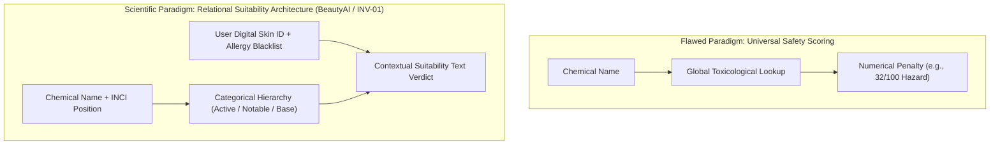

# CHAPTER 2: LITERATURE REVIEW

## 2.1 Introduction

The design and implementation of an ingredient-aware electronic commerce platform occupy a multidisciplinary nexus comprising cosmetic dermatology, information retrieval, applied artificial intelligence, and software engineering methodology. Developing computational solutions within this domain necessitates reconciling empirical pharmacological realities with the operational constraints of consumer-facing digital storefronts.

This chapter critically reviews the foundational literature across seven thematic pillars:
1. Economic and behavioural dimensions of cosmetic e-commerce;
2. The scientific epistemologies of cosmetic ingredient transparency and the critique of numerical "safety scoring";
3. The computational mechanics and limitations of algorithmic recommender systems;
4. The dermatological evidence governing active-ingredient incompatibilities;
5. The deployment of Large Language Models (LLMs) with retrieval grounding and domain-specific guardrails;
6. The software engineering paradigms governing autonomous AI coding agents; and
7. The prevailing national and international regulatory frameworks.

By synthesising these diverse bodies of scholarship, this review identifies the critical technological and methodological gap that BeautyAI seeks to bridge.

---

## 2.2 Cosmetics E-Commerce and Information Asymmetry

Electronic commerce in personal care products exhibits structural dynamics fundamentally distinct from conventional fast-moving consumer goods (FMCG). Grounded in the economics of information formulated by Akerlof (1970) and extended to digital commerce by Bakos (1997), cosmetic formulations represent quintessential "experience goods" that frequently veer into "credence goods" (Darby and Karni, 1973). While a consumer can observe the aesthetic packaging or olfactory profile of a cosmetic serum, its biological efficacy, dermal penetrative capability, and propensity to provoke sub-clinical irritation remain imperceptible prior to transactional commitment.

Historically, cosmetic retail mitigated this informational deficit through tactile, in-person advisory interactions at brick-and-mortar beauty counters. The rapid migration toward digital distribution channels—accelerated by social commerce platforms and direct-to-consumer (D2C) brands—has detached the purchasing event from personalised human expertise. Consequently, modern digital consumers frequently fall victim to the "skintellectual paradox" (Smith et al., 2021): while consumers possess unprecedented access to chemical nomenclature, their analytical literacy remains constrained.

Digital storefronts exacerbate this friction by treating mandatory International Nomenclature of Cosmetic Ingredients (INCI) disclosures as passive, static regulatory texts rather than searchable, relational domain entities. Consumers are left to navigate uncurated user-generated reviews, which are systematically distorted by "crowd-sourced perception bias"—evaluations authored by individuals whose biological sebum excretion rates, stratum corneum integrity, and environmental exposures diverge diametrically from those of the reader.

---

## 2.3 Ingredient Transparency and the "Safety Score" Controversy

### 2.3.1 Pharmacological Epistemology: The Dose Makes the Poison

In response to heightened consumer vigilance regarding chemical exposures, commercial software developers introduced mobile scanning applications such as Yuka, Think Dirty, and Environmental Working Group (EWG) Healthy Living. These platforms aggregate ingredient lists and compute a singular, scalar "Hazard" or "Safety Score" (frequently rendered as a red-to-green traffic light indicator or a 0–100 percentile). Despite immense commercial adoption, this methodology has been comprehensively repudiated by regulatory toxicologists, academic dermatologists, and cosmetic chemists (Cosmetics Europe, 2020; Royal Society of Chemistry, 2022).

The core epistemological flaw of universal safety scoring resides in its explicit violation of the foundational tenet of modern toxicology formulated by Paracelsus in the sixteenth century: *"Dosis sola facit venenum"* (solely the dose determines the poison) (Gallo, 2018). Chemical toxicity is not an intrinsic, binary attribute possessed by a molecular structure; it is an empirical function of cumulative exposure, dermal penetration, vehicle formulation, and physiological concentration.

For instance, commercial applications routinely flag ubiquitous cosmetic preservatives—such as Phenoxyethanol, Parabens, or Sodium Benzoate—with punitive hazard ratings based on high-dose rodent ingestion studies. In cosmetic formulations, however, these compounds are legally restricted by the European Scientific Committee on Consumer Safety (SCCS) and the ASEAN Cosmetic Directive to strict safe thresholds (e.g., Phenoxyethanol capped at ≤ 1.0%). By failing to ingest or parse quantitative concentrations—which manufacturers treat as proprietary trade secrets—scoring algorithms equate trace preservative systems indispensable for antimicrobial stability with hazardous, unbuffered industrial chemicals.

### 2.3.2 The Flawed Epistemology of Comedogenicity Scales

A parallel methodological failure occurs in the computational handling of comedogenicity ratings (the propensity of an ingredient to clog follicular pores and induce acne vulgaris). Commercial e-commerce filters routinely compute aggregate "acne-safe" metrics based on traditional rabbit ear assay tables established by Kligman and Mills (1972). Subsequent dermatological research has dismantled the clinical validity of directly extrapolating these animal assays to human facial biology (Fulton, 1989; Draelos and DiNardo, 2006).

The rabbit ear canal possesses hyper-sensitive follicular infundibula that overreact to pure chemical compounds (e.g., neat isopropyl myristate or pure coconut oil) applied occlusively. When formulated into an emulsion at concentrations below 5%, these ingredients demonstrate negligible comedogenicity in human clinical trials. Consequently, treating comedogenicity as an additive scalar metric introduces significant false-positive exclusions, depriving consumers of deeply hydrating barrier formulations.

### 2.3.3 The Ethical and Architectural Imperative for Invariant INV-01

The systemic distortion introduced by commercial hazard algorithms produces severe negative externalities: it fosters chemophobia and unscientific consumer alarmism; it penalises safe, shelf-stable formulations; and it induces cognitive exhaustion through reductionist oversimplification.

*Figure 2.1: Paradigm Shift from Universal Hazard Scoring to Relational Suitability Verdicts (INV-01).*

To preserve scientific rigour and consumer trust, this project establishes **System Invariant INV-01**: *The platform shall strictly prohibit the computation, persistence, or presentation of universal numerical "Safety Scores", "Hazard Indexes", or percentile safety ratings.* Instead of an absolute score, BeautyAI operationalises a relational paradigm: **Suitability Verdicts** rendered as deterministic categorical descriptors (e.g., `Good Match`, `Match with Notes`, `Not Suitable — Allergy Alert`) computed dynamically against the user's specific Digital Skin ID and documented personal contraindications.

**Table 2.1: Comparative Analysis of Cosmetic Ingredient Intelligence Platforms**

| Evaluation Dimension | Yuka / Think Dirty | EWG Skin Deep | INCIDecoder / SkinSort | BeautyAI (Proposed Platform) |
|---|---|---|---|---|
| **Primary Metric** | Scalar Hazard Score (0–100 or Traffic Light). | Numerical Hazard Score (1–10). | Descriptive Role Badges & Comedogenic Index. | Relational Suitability Verdict (Categorical Text). |
| **Toxicological Baseline** | Hazard-based identification (hazard *per se*). | Mixed hazard assessment; neglects formulation matrix. | Ingredient function tagging (CosIng derived). | Risk-based contextual assessment; formulation-matrix aware. |
| **Personalised Allergy Guard** | None; static global rating across all users. | Manual search required; no profile matching. | Partial allergen tracking (account required). | Automated Zero-Allergen Exclusion via Skin ID Blacklist. |
| **Active Conflict Engine** | Absent. | Absent. | Superficial warning text on isolated ingredients. | Pairwise Smart Conflict Detector across Active Carts & Routines. |
| **E-Commerce Integration** | Disconnected affiliate links; external redirection. | Non-transactional catalog database. | Purely informational blog/aggregator. | Fully Integrated Commerce Platform (.NET 10 / React 19). |
| **Dermatological Rigour** | Low; criticised for anti-chemical alarmism. | Low-to-Moderate; conflates hazards with risks. | Moderate; objective cosmetic science literature. | High; enforces INV-01, CosIng mapping & 12 clinical conflict rules. |

---

## 2.4 Personalisation and Recommender Systems in Skincare

Algorithmic recommendation in consumer retail relies fundamentally on three traditional paradigms: Collaborative Filtering (CF), Content-Based Filtering (CBF), and Hybrid Systems (Ricci, Rokach and Shapira, 2015). However, deploying these orthodox mathematical models directly within cosmetic dermatology exposes acute algorithmic deficiencies.

### 2.4.1 The Collapse of Collaborative Filtering in Dermal Biology

Collaborative filtering techniques—such as matrix factorisation via Singular Value Decomposition (SVD) or user-based $k$-nearest neighbours ($k$-NN)—operate on the assumption that if User $A$ and User $B$ share historical rating concordances across items $X$, User $A$ will appreciate an item $Y$ highly rated by User $B$ (Su and Khoshgoftaar, 2009).

In skincare retail, this foundational assumption collapses under biological heterogeneity. Two users may both rate a lightweight hyaluronic acid essence with 5 stars; however, User $A$ possesses resilient, hyper-sebaceous, acne-prone skin, whereas User $B$ exhibits atopic, xerotic skin with compromised barrier lipids. Recommending a heavy, occlusive shea-butter lipid repair balm to User $A$ purely because User $B$ celebrated its restorative efficacy will likely induce severe acute follicular occlusion. The sparsity of the user-item interaction matrix, coupled with the biological unreliability of uncurated ratings, renders pure CF hazardous in health-adjacent contexts.

### 2.4.2 Knowledge-Based and Rule-Augmented Filtering

To overcome the failure modes of statistical collaborative filtering, domain-aware e-commerce requires **Knowledge-Based Recommendation Systems** (Burke, 2002). Knowledge-based engines leverage explicit domain constraints, mapping user requirements directly to product attributes via deterministic logic. In BeautyAI, this is realised through:
- A structured **Digital Skin ID** model (capturing skin type, sensitivity status, primary concerns, goals, budget, and personal chemical blacklists); and
- A multidimensional compatibility cascade mapping these parameters against the structural position of chemical entities within the INCI string.

Furthermore, while frequent-pattern itemset mining (such as the Apriori association algorithm formulated by Agrawal and Srikant, 1994) offers value in identifying supplementary purchases (e.g., associating a gentle cleanser with a balancing toner), it must be subordinated to strict dermatological safety filters. If an association rule computes high statistical lift between a chemical exfoliator and an unbuffered retinol serum, the underlying recommender architecture must intervene to prevent simultaneous transactional combination.

---

## 2.5 Active-Ingredient Interactions and Contraindications

The contemporary cosmetic landscape is characterised by the proliferation of single-ingredient clinical serums containing high concentrations of biologically active molecules. The unguided simultaneous application of multiple active formulations presents well-documented physiological hazards.

### 2.5.1 Clinical Evidence: Chemical Degradation and Barrier Breakdown

The dermatological literature establishes that specific chemical combinations induce direct molecular destabilisation or acute epidermal barrier impairment:

- **Benzoyl Peroxide and Tretinoin:** In a landmark pharmacological stability investigation, Martin et al. (1998) demonstrated that mixing free-form all-trans retinoic acid (Tretinoin) directly with Benzoyl Peroxide (BPO) results in rapid oxidative degradation of the retinoid molecule, rendering it biologically inert within two hours of co-formulation. While third-generation naphthoic-acid derivatives like Adapalene exhibit chemical stability when exposed to BPO, the simultaneous layering of high-potency oxidising agents with primary keratolytics dramatically exacerbates transepidermal water loss (TEWL) and barrier disruption.
- **Direct Acid Combinations:** The concurrent layering of low-pH Alpha Hydroxy Acids (Glycolic, Lactic acids; pH < 3.8) with Beta Hydroxy Acid (Salicylic acid) or high-strength Vitamin A derivatives compromises the intercellular lipid lamellae of the stratum corneum, precipitating irritant contact dermatitis and post-inflammatory hyperpigmentation (Burke, 2002).

### 2.5.2 Dermatological Nuance: The Vitamin C and Niacinamide Dilemma

The formulation discourse surrounding the combination of L-Ascorbic Acid (pure Vitamin C) and Niacinamide (Nicotinamide) provides an exemplary case study in scientific evolution and required system nuance.

Historically, mid-twentieth-century chemical studies demonstrated that under elevated temperatures (> 120 °C), prolonged exposure, and unbuffered acidic conditions, L-Ascorbic Acid and Niacinamide can react to form a 1:1 hydrogen-bonded complex, hydrolysing Niacinamide into free Nicotinic Acid (Niacin), a known cutaneous vasodilator that induces intense facial flushing (Bisset et al., 1989).

Modern cosmetic formulation literature has demystified this reaction as a laboratory artefact largely absent at room temperature on biological skin (Feldmann and Maibach, 1970; Levin and Momin, 2010). Both actives operate synergistically in photo-protective and pigment-modulating pathways ("Myth Correction"). However, an operational engineering nuance remains: L-Ascorbic Acid requires an acidic formulation vehicle (pH 3.0–3.5) to maintain unionised molecular penetration, whereas Niacinamide performs stably at near-neutral physiological levels (pH 5.5–6.5). Co-applying them simultaneously without an interval buffer can elevate the local dermal pH, reducing the transdermal bioavailability of Vitamin C and inducing transient sensory flushing in hyper-reactive, atopic consumers.

Consequently, a rigorous e-commerce conflict engine must avoid binary alarmism: in BeautyAI Phase 1, the runtime engine flags this pairing at a non-blocking **Warning** level, advising a pragmatic application buffer (e.g., a 20-minute separation or AM/PM scheduling) for sensitive profiles while dispelling outdated toxicity myths.

**Table 2.2: Dermatological Evidence Classification for Curated Active Ingredient Interactions**

| Active Pair | Primary Dermatological Risk | Clinical Evidence Level | Platform Severity & Action | Key Literature Citations |
|---|---|---|---|---|
| **Benzoyl Peroxide + Tretinoin (Free-form)** | Rapid oxidative degradation of Retinoid; severe barrier disruption. | Level I (High: Controlled pharmacological stability trials). | Contraindication (High); Immediate cart warning; recommend AM/PM split. | Martin et al. (1998); Del Rosso (2008). |
| **AHA/BHA Exfoliants + High-Potency Retinol** | Cumulative stratum corneum stripping; acute erythema and elevated TEWL. | Level II (Moderate: Well-documented clinical observational studies). | Warning (Medium); Recommend alternating evening cadence. | Burke (2002); Draelos (2019). |
| **Copper Peptides + Direct L-Ascorbic Acid** | Oxidation of Ascorbate; destabilisation and chelation of bioactive peptide complexes. | Level III (In-vitro biochemical stability & formulation trials). | Warning (Moderate); Advise separate AM/PM routine slots. | Pickart and Margolina (2018). |
| **L-Ascorbic Acid + Niacinamide** | Transient facial flushing due to pH divergence; theoretical complexing. | Level IV (Nuanced: Re-evaluated as modern formulation myth; kinetic pH disparity). | Warning / Informational; Dispel toxicity myths; advise 20-min buffering for sensitive profiles. | Bisset et al. (1989); Levin and Momin (2010). |

---

## 2.6 Large Language Models in E-Commerce: Grounding and Guardrails

The advent of Generative Pre-trained Transformers and multimodal Large Language Models has inaugurated a new paradigm in interactive retail assistance. Consumers increasingly demand conversational interfaces capable of synthesising complex product queries into actionable routines. However, deploying probabilistic language models within health-adjacent e-commerce introduces severe reliability risks (Ji et al., 2023).

### 2.6.1 The Phenomenon of Hallucination in Catalog Search

LLMs are ungrounded parametric neural networks optimised to maximise token sequence probability rather than factual veracity (Bender et al., 2021). When queried regarding skincare regimens, unconstrained LLMs routinely exhibit three categories of hallucinations:
1. **Catalog Hallucination:** Inventing plausible-sounding product SKUs, non-existent active concentrations, or attributing products to incorrect brands.
2. **Formulaic Hallucination:** Fabricating ingredient constituents (e.g., asserting a fragrance-free mineral sunscreen contains botanical essential oils).
3. **Medical Hallucination:** Offering clinical diagnostic assertions regarding inflammatory dermatoses (e.g., misidentifying severe pathological rashes as mild dry skin).

### 2.6.2 Retrieval-Augmented Generation (RAG) and Bounded Context

To eliminate parametric hallucination, software architectures must adopt **Retrieval-Augmented Generation (RAG)** paradigms (Lewis et al., 2020). Under RAG, the conversational prompt submitted to the generative model is strictly augmented with deterministic, retrieved contextual payloads extracted from the relational database. In BeautyAI, the external AI adapter (`GeminiSkincareProvider`, integrating Google Gemini 2.5 Flash) operates under an immutable system instruction: it is strictly constrained to recommend exclusively the in-stock catalog items supplied within the contextual payload, explicitly prohibited from generating hypothetical external products.

### 2.6.3 Domain-Specific Medical Guardrails

Beyond transactional grounding, consumer safety demands the programmatic enforcement of **Medical Guardrails**. Under internationally accepted principles of bioethics and digital health law, an automated retail assistant must never simulate the licensed practice of medicine (American Medical Association, 2023). When a user presents symptoms indicative of active pathological conditions—such as cystic acne, severe atopic eczema, plaque psoriasis, or cutaneous infections—the generative assistant (`Lumi`) must execute a deterministic redirect, declining diagnostic authority and explicitly advising consultation with a board-certified dermatologist.

---

## 2.7 AI Coding Agents and Specification-Driven Development

The software engineering landscape has witnessed an aggressive transition toward agentic development environments, typified by tools such as Google Antigravity, GitHub Copilot Workspace, and Claude Code. Contemporary software engineering research indicates that autonomous AI coding agents can execute end-to-end implementation tasks—writing boilerplate code, generating unit tests, and scaffolding API controllers—yielding documented productivity gains exceeding 40% (Peng et al., 2023).

However, recent empirical analyses of autonomous agent behaviour in complex codebases reveal critical failure modes:
- **Architectural Drift:** Agents consistently exhibit "local optimisation bias"—solving a localised prompt by introducing direct tight-coupling between disparate architectural layers, thereby violating Clean Architecture and Inversion of Control boundaries (Jimenez et al., 2024).
- **Hallucinated Dependencies:** When confronted with complex algorithmic tasks, agents frequently introduce unmaintained third-party packages or deprecated APIs, compromising long-term maintainability and software supply chain integrity.
- **Domain Invariant Erosion:** Without formal machine-verifiable constraints, agents progressively erode subtle domain rules (such as inadvertently re-introducing numerical safety scores or bypassing cryptographic password hashing for convenience).

Resolving this tension requires an evolution toward **Specification-Driven Development** (Agarwal et al., 2026). In this paradigm, the software engineering lifecycle is structured as an immutable hierarchy of formal documents: Business Requirements Documents (BRD), Product Requirements Documents (PRD), and Architecture Decision Records (ADRs). The AI agent does not operate on raw conversational intent; it operates strictly as an execution engine within the constraints of structured, human-governed task playbooks, while machine-enforced architectural test suites (`NetArchTest`) act as deterministic boundary guards.

---

## 2.8 Legal, Ethical, and Regulatory Context

Deploying an ingredient-aware e-commerce platform requires strict adherence to overlapping transnational and domestic regulatory frameworks.

### 2.8.1 Cosmetic Regulation and Labelling Standards

Cosmetic formulations in the Southeast Asian market are governed by the **ASEAN Cosmetic Directive (ACD)**, which harmonised regional regulations with the **European Union Cosmetic Regulation (EC No 1223/2009)**. Under these frameworks, manufacturers are legally bound to declare all intentionally added constituents using their standardised INCI names in descending order of concentration if present at > 1%; ingredients present at concentrations ≤ 1% may be listed in arbitrary order at the termination of the string. Formulations must comply with authoritative Annex lists of prohibited substances (Annex II) and restricted substances (Annex III), mirrored digitally via authoritative repositories such as the European Commission's CosIng database.

### 2.8.2 Vietnamese Regulatory Framework: Decree 181/2013/NĐ-CP

Within Vietnam, digital beauty retail and marketing are strictly governed by **Decree No. 181/2013/NĐ-CP** (guiding the Law on Advertising). Article 4 of the Decree prohibits any advertising, product description, or automated advisory text that misrepresents cosmetic products as having therapeutic or curative medicinal properties (*"hành vi quảng cáo mỹ phẩm gây hiểu nhầm là thuốc chữa bệnh"*). Terms such as *"dứt điểm"* (cure definitively) or *"điều trị triệt để"* (treat therapeutically) are legally restricted to pharmaceutical agents. Consequently, the conversational interface and copy in BeautyAI enforce strict linguistic boundaries, describing products strictly in terms of aesthetic maintenance, barrier support, and physiological hydration.

### 2.8.3 Data Protection and Dermal Privacy: Decree 13/2023/NĐ-CP

Digital consumer protection has undergone a decisive regulatory tightening with Vietnam's **Decree No. 13/2023/NĐ-CP on Personal Data Protection (PDPD)**, alongside the European General Data Protection Regulation (GDPR). Under Decree 13, user dermatological profiles, chemical allergy histories, and health-adjacent inputs constitute **Sensitive Personal Data** (*Dữ liệu cá nhân nhạy cảm*). Processing such data mandates explicit consumer consent, strict purpose limitation prohibiting unauthorised monetisation, and full user sovereignty over profile modification. BeautyAI's architecture directly enforces these mandates by isolating Digital Skin ID records behind authenticated, user-scoped endpoints with zero administrative browse access.

---

## 2.9 Summary and Research Gap

The critical evaluation of the existing literature illuminates a profound dual void in both commercial software applications and academic software engineering methodology:

1. **The Product Intelligence Gap:** Commercial e-commerce platforms remain polarised between reductionist, alarmist scanning utilities that deploy scientifically ungrounded "Safety Scores" and commercial storefronts that hide ingredient strings behind marketing hyperbole. There is an absence of production-grade platforms that integrate transparent 3-tier INCI progressive disclosure, personalised zero-allergen filtering, pairwise active conflict warnings with scheduling advice, and catalog-grounded AI consultation within a unified transaction pipeline.
2. **The Software Lifecycle Gap:** Contemporary software development models remain trapped between rigid, pre-AI methodologies (Waterfall, Spiral) that cannot accommodate modern delivery velocity, and unstructured Agile practices that suffer from severe architectural decay when paired with autonomous AI coding agents.

BeautyAI directly addresses this dual gap: it delivers a scientifically grounded, legally compliant cosmetic e-commerce platform while establishing and validating an empirical, document-driven software development lifecycle tailored to harness autonomous AI agents with uncompromising engineering rigour.
