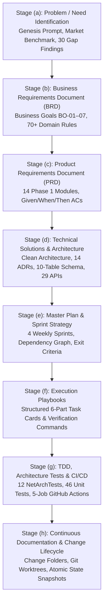
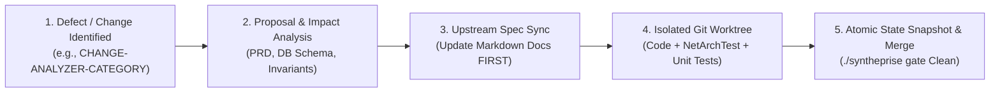
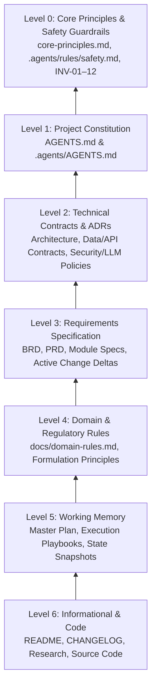

# CHAPTER 3: SOFTWARE DEVELOPMENT METHODOLOGIES AND THE PROPOSED AI-AGENT SDLC

## 3.1 Review of Classical Software Development Methodologies

The discipline of software engineering has historically codified development processes into formalised lifecycle models designed to manage complexity, mitigate operational risk, and align technical execution with stakeholder requirements. Over five decades of empirical practice, four foundational methodology paradigms have dominated academic literature and industrial engineering: the Linear Sequential (Waterfall) Model, the Risk-Driven Spiral Model, Rapid Application Development (RAD), and Agile/Scrum.

### 3.1.1 The Linear Sequential (Waterfall) Model

Formally conceptualised by Royce (1970), the Waterfall model enforces an orderly, non-iterative sequence of discrete engineering stages: requirements specification, system architectural design, programmatic implementation, integration testing, deployment, and operational maintenance. Each phase must achieve comprehensive formal verification and sign-off before downstream execution commences.

The primary pedagogical strength of the linear model lies in its procedural discipline, extensive documentary audit trails, and deterministic project boundaries. However, as demonstrated by Boehm (1988) and Sommerville (2015), Waterfall suffers from structural fragility when deployed in domains characterised by volatile requirements or emerging technologies. Because functional software is realised solely at the terminal stages of the lifecycle, late-breaking architectural defects or market-driven pivots require catastrophic rework at exponential economic cost.

### 3.1.2 The Risk-Driven Spiral Model

To reconcile the rigid documentation of Waterfall with iterative refinement, Boehm (1988) formulated the Spiral model. Organised as an expanding geometric helix, the model cycles continuously through four quadrant activities: determining objectives and constraints, evaluating risks and alternative solutions, engineering and verifying the current cycle's deliverables, and planning the subsequent iteration.

The paramount virtue of the Spiral paradigm is its explicit, institutionalised focus on risk assessment and systematic prototyping. Nevertheless, the framework imposes significant operational overhead: it demands advanced, specialised risk-assessment expertise and exhibits procedural complexity that makes it economically unviable and structurally cumbersome for small engineering teams or accelerated solo projects.

### 3.1.3 Rapid Application Development (RAD) and Evolutionary Prototyping

Pioneered by Martin (1991), Rapid Application Development arose as an explicit reaction to the documentary paralysis of traditional sequential lifecycles. RAD prioritises accelerated delivery cycles through visual evolutionary prototyping, computer-assisted software engineering (CASE) tooling, and time-boxed iterative construction.

While RAD fosters close user collaboration and compresses delivery schedules, it introduces dangerous technical trade-offs. The methodology frequently compromises non-functional systemic qualities—such as long-term architectural modularity, defensive security, database normalisation, and scalable data-access abstractions—in pursuit of superficial user-interface expediency.

### 3.1.4 Agile Methodologies and the Scrum Framework

Formally crystallised in the *Manifesto for Agile Software Development* (Beck et al., 2001) and operationalised through the Scrum framework (Schwaber and Sutherland, 2020), Agile represents the reigning industrial consensus. Scrum organises engineering labour into cross-functional teams executing time-boxed cadences (sprints lasting one to four weeks), governed by ceremonies (sprint planning, daily stand-ups, backlog refinement, sprint reviews, and retrospectives) and prioritising working software over comprehensive documentation.

Agile frameworks excel at empirical process control, enabling engineering teams to respond rapidly to evolving user feedback. However, Agile methodologies presuppose continuous human communicative bandwidth, real-time social consensus, and co-located or synchronously distributed human engineers.

**Table 3.1: Comparative Assessment of Traditional Software Development Methodologies**

| Evaluation Dimension | Waterfall (Royce, 1970) | Spiral (Boehm, 1988) | RAD (Martin, 1991) | Agile / Scrum (Schwaber & Sutherland, 2020) |
|---|---|---|---|---|
| **Primary Philosophy** | Rigorous sequential progression; verify then proceed. | Continuous risk mitigation through iterative cycles. | Rapid delivery via visual evolutionary prototyping. | Adaptive empirical change; working software over documentation. |
| **Requirements Volatility** | Intolerant; requires total upfront specification freeze. | Accommodates evolving risks at each quadrant cycle. | Highly adaptive; refined continuously via UI prototypes. | Welcomes changing requirements even late in development. |
| **Documentary Discipline** | Exhaustive, formal, gate-controlled documentation. | Formal risk assessments and milestone specifications. | Minimal; prioritises transient prototype code over specs. | Lean/Episodic; user stories, ephemeral burn-down charts. |
| **Architectural Governance** | High initial design, but vulnerable to implementation drift. | High; structured risk-driven architectural evaluation. | Low; frequently yields spaghetti or throwaway architectures. | Implicit; reliant on emergent design and human code reviews. |
| **Solo Developer Fit** | Low; excessive documentary paralysis for one engineer. | Very Low; prohibitive risk-assessment procedural overhead. | Moderate; effective for UI but deficient for enterprise core. | Low-to-Moderate; ceremonies designed for human collectives. |

---

## 3.2 Justification of Methodology Selection in an Agentic Context

The integration of autonomous AI coding agents (such as Google Antigravity, Claude Code, and GitHub Copilot Workspace) into the software engineering process creates a fundamental paradigm shift. Conventional software engineering methodologies—whether classical or agile—were formulated entirely on the unstated axiom that code is conceived, written, and verified exclusively by human cognitive faculties. When an autonomous AI agent enters the engineering loop as an active implementation partner for a solo developer, traditional methodologies experience acute systemic friction:

- **The Inadequacy of Classical Lifecycles:** Waterfall lacks the operational agility required to steer generative models. While comprehensive upfront documentation is theoretically desirable, Waterfall's sequential milestone gates prevent rapid iterative verification and responsive scope refinement.
- **The Failure of Pure Agile and the Peril of "Vibe Coding":** When solo developers pair Agile's minimal documentation philosophy with autonomous AI agents, the process rapidly degenerates into ungoverned *"Vibe Coding"*. Because conversational prompts and episodic user stories lack formal relational contracts, AI agents exhibit local optimisation bias: solving localised functional prompts by introducing direct layer coupling, hallucinating deprecated libraries, or silently eroding core business rules (Architectural Drift). Human code review rapidly becomes cognitively overwhelmed by the sheer volume of synthetic code.
- **The Justification for a Document-Driven SDLC:** To harness the throughput of AI coding agents without sacrificing system reliability, the engineering process must be anchored in **Specification-Driven Development** (Agarwal et al., 2026). The development lifecycle must be structured around an immutable hierarchy of formal documentation that functions as an absolute "source of truth." Autonomous agents must never execute against conversational whims; they must be constrained by structured playbooks, clear precedence rules, and automated, machine-enforced architectural tests.

---

## 3.3 The Proposed 8-Stage AI-Agent Document-Driven SDLC

To operationalise this paradigm, this project formulated and executed an empirical, eight-stage software development lifecycle—termed the **AI-Agent Document-Driven SDLC**—orchestrated via the **Syntheprise Framework v6.0.1**.

*Figure 3.1: The Proposed 8-Stage AI-Agent Document-Driven Software Development Lifecycle.*

The lifecycle enforces a rigorous unidirectional dependency flow from Stage (a) through Stage (h):

- **Stage (a) — Problem and Need Identification:** The lifecycle initiates with an exhaustive Problem Statement and Genesis Prompt. Rather than relying on superficial feature lists, this stage synthesises qualitative and quantitative domain research. In BeautyAI, Stage (a) produced an empirical market analysis uncovering the "Safety Score" controversy, ingredient illegibility, active-ingredient contraindications, and 30 specific industry gap findings across existing commercial platforms.
- **Stage (b) — Business Requirements Document (BRD):** The verified problem statement is transformed into a formal Business Requirements Document defining seven macro Business Objectives (`BO-01` to `BO-07`), over 70 granular Domain Rules across ingredient nomenclature, safety boundaries, user profiling, and commerce, explicit User Personas, and quantitative operational metrics (e.g., sub-100ms catalog query response times).
- **Stage (c) — Product Requirements Document (PRD):** Stage (c) translates high-level business rules into functional software specifications. The PRD formalises the 14 Phase 1 Functional Modules (`M01`–`M15`, excluding deferred Phase 2 comparison). Each functional requirement is modelled as an actionable User Story accompanied by formal `Given/When/Then` Acceptance Criteria.
- **Stage (d) — Technical Solutions and Architectural Design:** Stage (d) establishes the concrete engineering blueprints: the Four-Layer Clean Architecture model, the 10-table physical relational schema on PostgreSQL 17, the formal REST API contracts comprising 29 endpoints, and the complete suite of 14 Architecture Decision Records (`ADR-001` to `ADR-014`).
- **Stage (e) — Master Plan and Sprint Strategy:** Stage (e) constructs the temporal and operational schedule across four intensive weekly sprints spanning 28 calendar days (160 scheduled hours plus 20 buffer hours), defining explicit resource allocations, risk contingencies, and strict milestone exit criteria.
- **Stage (f) — Execution Playbooks:** The bridge between static documentation and active AI implementation is achieved through Execution Playbooks. Each sprint deliverable is deconstructed into atomic **Task Cards** adhering to a six-part template: (1) Task Metadata, (2) Context & Objective, (3) File Scope whitelist, (4) Step-by-Step Implementation Instructions, (5) Verification Commands, and (6) Binary Acceptance Criteria.
- **Stage (g) — TDD, Automated Architectural Testing, and CI/CD:** Implementation proceeds under Test-Driven Development (TDD) (Beck, 2003), augmented with automated Architecture Tests via `NetArchTest`. Before writing business logic, tests verify Clean Architecture layer isolation and domain invariants (such as machine-checking that no class or JSON attribute contains the substring `SafetyScore`). Continuous Integration is enforced via a five-job GitHub Actions workflow covering build validation, unit tests, architecture tests, secret scanning, and Syntheprise specification checks.
- **Stage (h) — Continuous Documentation and the Change Lifecycle:** When defects are uncovered or refactoring is required, code is never modified in isolation. Stage (h) governs systemic updates through a formal Change Management Protocol: (1) Proposal & Impact Analysis, (2) Specification Synchronisation (updating upstream BRD/PRD/ADRs first), (3) Isolated Git Worktree Execution, and (4) Atomic State Snapshot capture and merge.

*Figure 3.2: Continuous Documentation and Change Management Workflow.*

---

## 3.4 Governance and Safety Mechanisms

To maintain deterministic control over autonomous AI agents across all eight stages, the Syntheprise Framework institutes three foundational governance mechanisms: the Document Precedence Ladder, System Invariants, and the Human-Agent RACI Governance model.

### 3.4.1 The Constitutional Document Precedence Ladder

A primary failure mode of AI coding agents is resolving ambiguous requirements by fabricating synthetic logic. The SDLC prevents this by establishing a strict, immutable **Constitutional Precedence Ladder** (`AGENTS.md §0`), where lower numbers hold higher authority:

*Figure 3.3: The Constitutional Document Precedence Ladder (Lower Number Wins).*

Whenever an autonomous agent detects a contradiction between artefacts, the conflict is resolved deterministically by deferring to the higher-ranking authority. Crucially, runtime source code resides at the lowest precedence tier: code must conform to specifications and invariants—specifications are never silently weakened to accommodate expedient code.

### 3.4.2 System Invariants (INV-01 to INV-12)

To provide machine-verifiable boundaries that AI agents cannot erode, the architecture codifies twelve non-negotiable System Invariants, including:

- **INV-01 (Prohibition of Universal Safety Scores):** Absolute ban on numerical safety/hazard scoring across classes, properties, and JSON attributes; mandatory use of contextual text-based `SuitabilityVerdict`.
- **INV-02 (INCI Order Preservation):** Ingredient ordering reflects packaging concentration tiers; proprietary percentages are never fabricated.
- **INV-03 (Evidence-Proportional Conflict Warnings):** Active conflict warnings provide non-blocking educational scheduling guidance without restricting checkout autonomy.
- **INV-04 (Zero-Allergen Exclusion):** Products matching a user's active Allergy Blacklist (and cosmetics lacking manufacturer INCI data) are strictly excluded when *"Safe For My Skin"* is enabled.
- **INV-05 (Database Grounding & Relational Truth):** PostgreSQL 17 serves as the single source of truth; AI product recommendations are strictly grounded to verified database records.
- **INV-06 (Clean Architecture Isolation):** `BeautyAI.Domain` maintains zero external NuGet or framework dependencies; `BeautyAI.Application` never references EF Core or ASP.NET Core.
- **INV-07 (Dermal Privacy Isolation):** Digital Skin ID endpoints derive identity exclusively from authenticated JWT claims—never from URL `userId` parameters—and remain inaccessible to administrative browse endpoints.
- **INV-08 (Cryptographic Credential Hygiene):** All passwords are hashed via PBKDF2 HMAC-SHA256 (600,000 iterations + cryptographic salt); secrets never enter source control.
- **INV-09 & INV-10 (Phase 1 Currency & Linguistic Standardisation):** Phase 1 operates consistently in English and USD (`$`) aligned with the Sephora dataset.
- **INV-11 (Medical Boundary & Disclaimer):** The AI assistant (`Lumi`) strictly declines clinical diagnosis of severe dermatological pathologies and directs users to board-certified dermatologists.
- **INV-12 (Atomic Documentation Synchronisation):** Code changes touching contracts, schema, or behaviour require synchronised documentation updates and an atomic State Snapshot.

### 3.4.3 Human-Agent Governance and RACI Matrix

A critical risk in agentic software engineering is the abdication of human accountability. Under the proposed SDLC, the human engineer retains absolute sovereignty over architectural decisions, domain ethics, and final verification, while the AI coding agent serves as a high-throughput execution partner (Table 3.2).

**Table 3.2: Human vs. AI-Agent Responsibilities Across Lifecycle Stages (a)–(h)**

| Lifecycle Stage | Human Engineer (Lead Architect) | Autonomous AI Coding Agent (Executor) | Governance / Quality Verification Gate |
|---|---|---|---|
| **Stage (a): Problem Identification** | **Accountable:** Defines business vision, ethics, and domain scope. | **Consulted:** Conducts market research, literature synthesis, and gap analysis. | Human approval of Stage (a) Genesis Document. |
| **Stage (b): Business Requirements** | **Accountable:** Authorises domain rules, invariants, and success metrics. | **Responsible:** Drafts formal BRD text, traceability matrices, and personas. | Review against business goals; cross-check `INV-01`. |
| **Stage (c): Product Requirements** | **Accountable:** Validates functional scope, module definitions, and ACs. | **Responsible:** Generates detailed User Stories and Given/When/Then criteria. | Precedence check against Constitution and BRD. |
| **Stage (d): Technical Solutions** | **Accountable:** Selects tech stack, decides ADRs, approves DB schema. | **Responsible:** Scaffolds Clean Architecture, writes EF Core mappings, drafts DTOs. | Architecture Review; `NetArchTest` scaffolding. |
| **Stage (e): Master Planning** | **Accountable:** Allocates timeline, manages budget, approves exit criteria. | **Informed:** Estimates task complexity; maps dependency graphs. | Sprint gate sign-off; resource allocation freeze. |
| **Stage (f): Execution Playbooks** | **Accountable:** Reviews and issues Task Cards; verifies file scopes. | **Responsible:** Translates PRD requirements into atomic execution task cards. | Playbook validation against Level 2 Contracts. |
| **Stage (g): TDD & Implementation** | **Accountable:** Reviews test results, monitors git commits, inspects PRs. | **Responsible:** Implements domain logic, writes unit tests, fixes build defects. | Automated Gate: 12 Arch Tests, 46 Unit Tests, 5-job CI. |
| **Stage (h): Continuous Documentation** | **Accountable:** Authorises architectural changes and signs off snapshots. | **Responsible:** Updates markdown specs, captures state snapshots, runs git diff. | `./syntheprise gate` Clean verification (0 errors). |

Through the disciplined orchestration of the eight-stage lifecycle, the constitutional precedence ladder, the twelve domain invariants, and the human-governed RACI framework, the AI-Agent Document-Driven SDLC demonstrates that an individual engineer can design, implement, and verify an enterprise-grade digital commerce platform with uncompromising architectural rigour.
