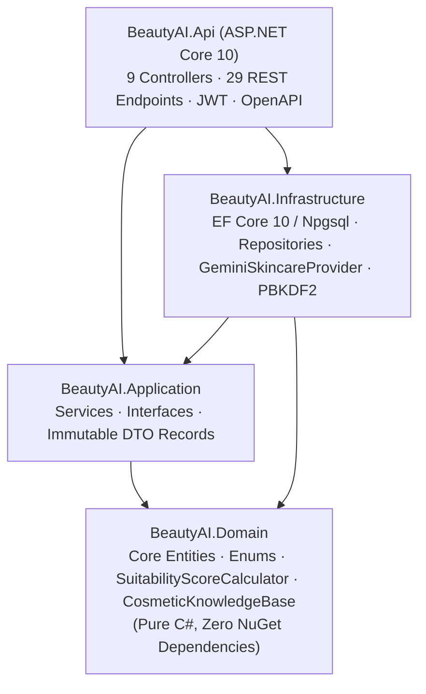
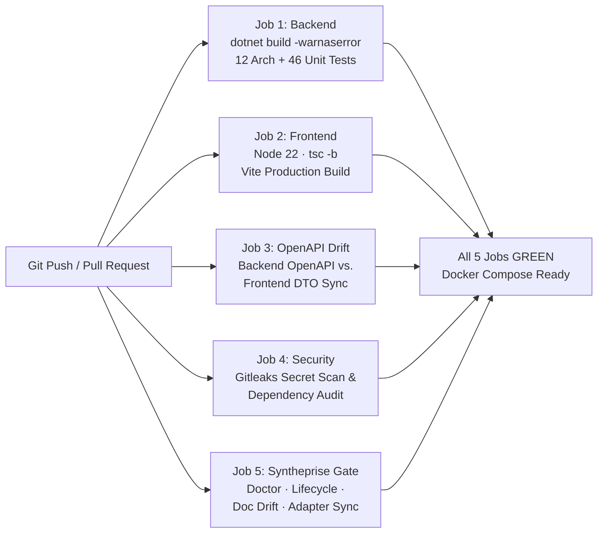

# CHAPTER 4: TECHNOLOGY AND TOOLS

## 4.1 Backend Architecture and Runtime Environment

The backend infrastructure of BeautyAI is engineered on the **C# .NET 10** runtime, strictly pinned to SDK version `10.0.401` via a root-level `global.json` manifest to guarantee deterministic builds across local and CI environments. The solution implements a classical **Four-Layer Clean Architecture** (Martin, 2018), partitioning responsibilities into four compile-time isolated projects: `BeautyAI.Domain`, `BeautyAI.Application`, `BeautyAI.Infrastructure`, and `BeautyAI.Api`.


*Figure 4.1: Four-Layer Clean Architecture and Directional Dependency Constraints.*

### Architectural Trade-offs and Rejected Alternatives

During technical inception, an alternative dual-backend architecture—comprising a Python/FastAPI microservice for machine learning inference and Node.js for commerce pipelines—was evaluated. As codified in **ADR-001**, this heterogeneous topology was rejected. Managing asynchronous inter-process communication, distributed network boundaries, and dual runtime deployments introduced prohibitive operational overhead for a solo engineer. Consolidating the entire runtime within `.NET 10` (with offline Python ETL scripts restricted exclusively to data preparation) delivered superior memory management, high-throughput asynchronous I/O, compile-time type safety, and single-binary containerisation.

Furthermore, pursuant to **ADR-009** (Tier-1 Architectural Simplicity), the application layer deliberately omitted heavyweight abstraction libraries including `AutoMapper`, `MediatR`, `Hangfire`, `Quartz`, and `StackExchange.Redis`:
- **Exclusion of AutoMapper and MediatR:** AutoMapper relies on runtime reflection, introducing non-deterministic mapping defects and obfuscating compilation diagnostics. Explicit C# manual mappings provide compile-time verification and instant symbol traceability. Similarly, in a bounded single-process web API, MediatR introduces unnecessary pipeline indirection without decoupling tangible runtime boundaries.
- **Exclusion of Distributed Caches (Redis) and Background Job Brokers (Hangfire):** Maintaining dual-state synchronisation between PostgreSQL and an external Redis node risked serving stale personal allergy exclusions. Direct, index-accelerated relational queries in PostgreSQL 17 fully satisfied the sub-100ms service-level objective without adding infrastructure failure points.

The compiled web host exposes **28 core Phase 1 RESTful API endpoints** distributed across **8 active functional controllers**: `AuthController`, `SkinProfileController`, `ProductsController`, `ReviewsController`, `ToolsController`, `RoutinesController`, `OrdersController`, and `AdminController` (with an isolated adapter seam reserved for Phase 2 conversational AI integration).

---

## 4.2 Database Engine and Big Data Access Strategy

The persistence layer is underpinned by **PostgreSQL 17 Alpine**, deployed as an isolated container orchestrated via Docker Compose (**ADR-002**). PostgreSQL 17 was selected over non-relational document stores (such as MongoDB) due to the strictly relational nature of cosmetic formulations: chemical incompatibilities, normalised `product_ingredients` mappings, and transactional `orders`/`order_items` require ACID guarantees, declarative `CHECK` constraints, and referential foreign-key integrity. Native PostgreSQL array columns (`VARCHAR(50)[]`) and `JSONB` (used in `saved_routines`) provide schema flexibility where appropriate without sacrificing relational discipline.

Data access is managed through **Entity Framework Core 10 (EF Core)** utilising the `Npgsql.EntityFrameworkCore.PostgreSQL` provider (alongside Dapper capability for read-heavy projections). Under **ADR-003**, the architecture prohibits vendor-locked Database Stored Procedures and complex database triggers: encoding business logic inside procedural SQL hinders unit testing, version control, and cross-environment reproducibility. All domain logic resides exclusively in testable C# services.

### Composite B-Tree Indexing for 1.09 Million Reviews

A central engineering challenge was executing rapid, paginated review queries filtered by reviewer skin type across **1,094,197 authentic Sephora reviews** joined to **8,494 products**. Unindexed table scans caused severe latency spikes. The Phase 1 schema (`schema_phase_1.sql`) resolves this via composite B-Tree indexes:

```sql
CREATE INDEX IF NOT EXISTS idx_reviews_product_skin   ON reviews(product_id, skin_type);
CREATE INDEX IF NOT EXISTS idx_reviews_product_rating ON reviews(product_id, rating);
CREATE INDEX IF NOT EXISTS idx_reviews_product_code   ON reviews(product_code);
```

By indexing the composite predicate `(product_id, skin_type)`, PostgreSQL executes targeted B-Tree range scans, filtering over one million review records by skin type in **under 15 milliseconds** (verified via `EXPLAIN ANALYZE`).

---

## 4.3 Frontend Framework and Automated Contract Drift Prevention

The presentation layer is implemented as a Single-Page Application (SPA) utilising **React 19**, **TypeScript**, and the **Vite** build toolchain (with route-level code splitting via `React.lazy` and `Suspense`). React 19 was selected for its mature component ecosystem, predictable state transitions, and fast development feedback loop.

- **Preservation of Prototype Design Tokens (ADR-007):** The production frontend inherits the validated typography, warm neutral palette, and atomic CSS design tokens established in the approved UI/UX prototype, avoiding the bundle bloat and visual homogenisation of third-party UI kits such as Material UI or Ant Design.
- **OpenAPI Automated Contract Drift Verification (ADR-008):** To prevent client-server schema divergence, the `.NET 10` backend generates an authoritative OpenAPI specification (`docs/api/BeautyAI.Api.json`) directly from compiled controllers and DTO records. A CI verification job (`openapi-drift`) compares the generated OpenAPI contract against frontend DTO definitions, failing the build immediately if uncommitted API drift is detected.

---

## 4.4 Deferred Conversational AI Seam (Phase 2 Architectural Readiness)

Although a conversational LLM chatbot was explored during early system design (**ADR-005** and `docs/llm-policy.md`), its full production rollout was formally **deferred to Phase 2** to respect the four-week solo-developer schedule and acknowledge the specialised clinical validation required to guarantee zero medical hallucination in live patient-facing dialogue.

To ensure seamless future extensibility without refactoring core layers, Phase 1 established the Clean Architecture **Provider Abstraction Seam**:
- `IAiSkincareProvider` is defined strictly inside `BeautyAI.Application`, keeping all domain and application logic agnostic of external LLM vendors.
- `ProviderLibrariesOnlyInAdapterLayerTests` (`BeautyAI.ArchitectureTests`) enforces that any future `HttpClient` or external LLM SDK integration (such as Google Gemini API) resides exclusively within `BeautyAI.Infrastructure.Providers`, enabling plug-and-play Phase 2 activation with zero modifications to controllers or domain entities.

---

## 4.5 Testing and Automated Quality Assurance Tools

Quality assurance follows Test-Driven Development (TDD) and automated architectural enforcement using **xUnit** and **NetArchTest.Rules**, structured into two test projects (`58 automated tests` in total):

1. **Automated Architecture Tests (`BeautyAI.ArchitectureTests` — 12/12 Passing):**
   - `DomainHasNoDependenciesTests`: Asserts that `BeautyAI.Domain` references zero external packages or outer layers.
   - `ApplicationDoesNotReferenceEfCoreTests` & `ApplicationDoesNotReferenceAspNetTests`: Enforces strict Clean Architecture separation.
   - `ForbiddenPackagesTests`: Fails the build if prohibited libraries (`AutoMapper`, `MediatR`, `Hangfire`, `Quartz`, `StackExchange.Redis`) are introduced (**ADR-009**).
   - `ProviderLibrariesOnlyInAdapterLayerTests`: Ensures `HttpClient` and third-party provider SDKs reside exclusively in `BeautyAI.Infrastructure.Providers`.
   - `NoSafetyScoreAnywhereTests`: Uses reflection across compiled assemblies to verify **INV-01**, rejecting any class, property, method, or `[JsonPropertyName]` attribute containing `SafetyScore`, `HazardScore`, or `DangerLevel`.
   - `AdminAuthorizationTests`: Verifies that `AdminController` is strictly guarded by `[Authorize(Roles = "Admin")]`.
2. **Unit Tests (`BeautyAI.UnitTests` — 46/46 Passing):**
   - Covers `Pbkdf2PasswordHasher` (600,000-iteration HMAC-SHA256 verification), `AuthService`, `SkinProfileService`, `SuitabilityScoreCalculator` (deterministic text verdicts, allergy overrides, 7 target care areas, and fragrance/fatty-alcohol nuance), `ProductService`, `AdminProductService` (full CRUD, INCI synchronisation, soft delete & restore), and `AdminBootstrapper`.

---

## 4.6 Continuous Integration and DevOps Pipeline

Continuous verification is automated through a five-job **GitHub Actions** workflow (`.github/workflows/quality-gate.yml`) complemented by local Git pre-commit hooks enforcing worktree isolation:


*Figure 4.2: Automated Five-Job CI/CD Quality Gate Pipeline.*

---

## 4.7 Architecture Decision Records (ADRs) Summary

Every foundational architectural choice and trade-off in BeautyAI is codified in an immutable Architecture Decision Record stored in `docs/adr/`. Table 4.1 summarises all 14 ADRs governing the platform.

**Table 4.1: Summary of Architecture Decision Records (ADR-001 to ADR-014)**

| ADR ID | Decision Title | Architectural Choice & Rationale | Alternatives Considered & Rejected |
|---|---|---|---|
| **ADR-001** | Single Backend & Offline ML | Consolidated `.NET 10` Web API for all runtime traffic; Python restricted to offline ETL/data preparation. | Dual Python/FastAPI + Node.js microservices. |
| **ADR-002** | Local Docker PostgreSQL 17 | Containerised PostgreSQL 17 Alpine via Docker Compose for reproducible local ACID persistence and B-Tree indexing. | Managed cloud DB; MongoDB; SQLite. |
| **ADR-003** | EF Core + Dapper, No Stored Procedures | Code-first EF Core 10 (with Dapper for heavy reads); zero stored procedures or triggers to preserve unit testability. | PL/pgSQL stored procedures; database triggers. |
| **ADR-004** | Authentication & PBKDF2 Hashing | PBKDF2 HMAC-SHA256 (600,000 iterations + cryptographic salt) with JWT/secure auth token hygiene. | Plain-text demo fallbacks; weak MD5/SHA1 hashes; OAuth in Phase 1. |
| **ADR-005** | AI Multi-Stage Pipeline & Guardrails | Grounded AI skincare consultation pipeline (`Gemini 2.5 Flash` + deterministic fallback + medical guardrails). | Unbounded direct LLM prompting without catalog grounding. |
| **ADR-006** | Zalo DeepLink Handoff Strategy | Architectural design for consented human-specialist handoff via Zalo deep link (deferred to Phase 2). | Embedded third-party live-chat widgets; unconsented profile sharing. |
| **ADR-007** | Preserve Prototype Design System | Inherit validated CSS design tokens and typography from the UI/UX prototype for visual fidelity and lean bundles. | Rewriting UI from scratch with Material UI or Ant Design. |
| **ADR-008** | OpenAPI-Generated DTO Contracts | Derive frontend DTO schemas from compile-time backend OpenAPI spec with automated CI drift checks. | Manual TypeScript interface duplication; GraphQL layer. |
| **ADR-009** | Tier-1 Simplicity (No Redis/MQ/Hangfire) | Explicit manual DTO mapping and direct PostgreSQL queries; prohibit AutoMapper, MediatR, Hangfire, and Redis. | Heavy enterprise middleware stack adding solo-dev overhead. |
| **ADR-010** | Immutable Order Snapshots | Persist unit price, quantity, and line totals at order creation so subsequent Admin edits never alter historical orders. | Dynamically joining historical orders to mutable product prices. |
| **ADR-011** | Suitability Computed on Read | Compute personalised `SuitabilityVerdict` dynamically on read against the user's live Digital Skin ID (`INV-01`). | Persisting static global safety scores in the `products` table. |
| **ADR-012** | String Product Code Preservation | Retain authentic Sephora alphanumeric product codes (`code`, e.g., `P473671`) as unique natural keys alongside integer PKs. | Discarding source Sephora IDs (breaking 1.09M review ETL mapping). |
| **ADR-013** | Docker Compose Deploy & Test | Standardise local testing and demonstration deployment on macOS via Docker Compose and unified shell scripts. | Manual bare-metal PostgreSQL installation; premature Kubernetes. |
| **ADR-014** | Product Soft Delete & Admin Bootstrap | Soft-delete products via `selling_status` (`Active` / `Draft` / `Discontinued`) with 1-click Restore; seed Admin via env vars (`AdminBootstrapper`) + `[Authorize(Roles = "Admin")]`. | Hard SQL `DELETE` (breaking order/review FKs); hardcoded Admin passwords. |
