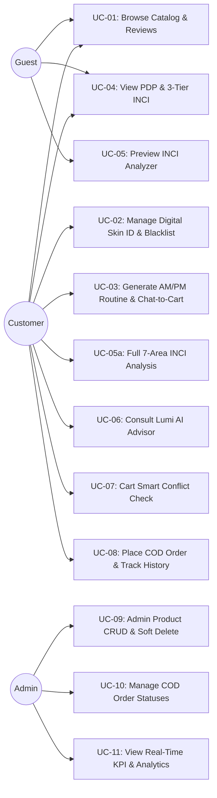
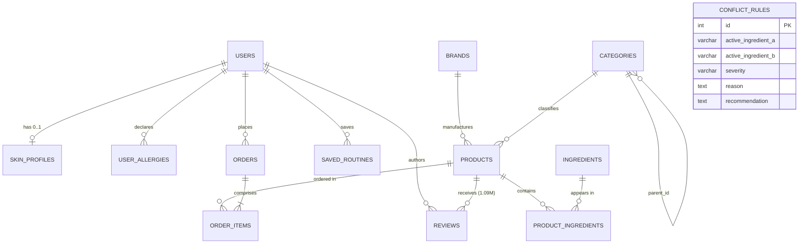
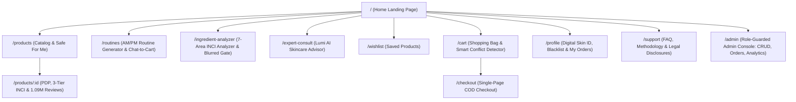

# CHAPTER 5: SOFTWARE PRODUCT REQUIREMENTS

## 5.1 Review of Similar Products and Market Gap Analysis

To establish an empirical baseline for functional requirements, six prominent commercial platforms operating across digital skincare, cosmetic analysis, and e-commerce were benchmarked: **Yuka**, **INCIDecoder**, **SkinSort**, **Haut.AI**, **Hasaki**, and **Sociolla**.

### 5.1.1 Critical Benchmark of Existing Solutions

- **Yuka (Mobile Barcode Scanner):** Yuka popularised consumer barcode scanning by assigning products a composite 0–100 numerical score alongside a traffic-light risk badge. However, its toxicological methodology conflates intrinsic chemical hazards with actual consumer risk, neglecting exposure concentration and the dermal formulation matrix. Crucially, Yuka is purely a third-party audit utility; it provides no transactional e-commerce infrastructure, lacks active conflict detection across product combinations, and cannot filter catalogs against an authenticated, personalised allergy blacklist.
- **INCIDecoder (Cosmetic Ingredient Database):** INCIDecoder provides educational breakdowns of cosmetic formulations, categorising ingredients by functional role based on cosmetic science literature and the European Commission's CosIng database. While respected for scientific objectivity, the platform operates primarily as an informational wiki and affiliate directory. It lacks personalised compatibility verdicts against a structured skin profile, cannot construct conflict-free AM/PM routines, and offers no native checkout.
- **SkinSort (Skincare Routine & Compatibility Tool):** SkinSort allows registered users to analyse cosmetic formulations and track custom routines. While it flags potential skin-type mismatches, its recommendations rely heavily on crowd-sourced tags and conventional comedogenicity tables. Furthermore, it lacks native e-commerce fulfilment, integrated COD order processing, and catalog-grounded conversational AI consultation.
- **Haut.AI (B2B Computer-Vision Dermal Analytics):** Haut.AI represents the technological benchmark for optical skin diagnostics, utilising convolutional neural networks to evaluate facial pigmentation, redness, and pore visibility. However, Haut.AI is licensed strictly as a B2B SaaS integration for clinical brands rather than an end-to-end consumer storefront with ingredient conflict detection.
- **Hasaki and Sociolla (Regional E-Commerce Storefronts):** Hasaki (Vietnam) and Sociolla (Southeast Asia) are leading omni-channel beauty retailers excelling at promotional campaigns, rapid fulfilment, and loyalty programmes. Nevertheless, both storefronts treat INCI ingredient declarations as passive, static text blocks. Neither offers dynamic zero-allergen catalog exclusion, pairwise active-ingredient conflict checking inside the shopping cart, or sub-20ms review filtering by reviewer skin type.

### 5.1.2 The Identified Market Gap

The competitive landscape reveals a clear structural void: commercial platforms are polarised between informational scanning apps that rely on scientifically ungrounded numerical "hazard scores" without transactional capability, and retail storefronts that optimise for sales conversion while ignoring consumer ingredient vulnerabilities. BeautyAI bridges this gap by unifying a full transactional e-commerce platform with a scientifically grounded, non-punitive ingredient intelligence engine.

---

## 5.2 Requirements Engineering (BRD & PRD Phase 1)

### 5.2.1 High-Level Business Objectives

The functional and non-functional requirements derive directly from seven core Business Objectives codified in the Business Requirements Document (BRD):

- **BO-01 (Dermatological Ingredient Transparency):** Provide structured, 3-tier progressive disclosure of INCI nomenclature across catalog products without computing universal safety scores (`INV-01`).
- **BO-02 (Automated Consumer Safety & Allergy Exclusion):** Enable instantaneous catalog filtering to exclude personal allergens documented in the user's Digital Skin ID (`INV-04`).
- **BO-03 (Active-Ingredient Contraindication Mitigation):** Detect potential active-ingredient clashes across cart items and daily routines, delivering non-blocking educational scheduling advice (`INV-03`).
- **BO-04 (Contextualised Social Proof):** Segment 1.09 million consumer reviews dynamically by reviewer biological skin type to eliminate crowd-sourced rating bias.
- **BO-05 (Grounded Conversational Assistance):** Deploy an AI skincare advisor (`Lumi`) grounded strictly within verified in-stock catalog inventory, enforcing explicit medical boundaries (`INV-07`, `INV-11`).
- **BO-06 (Streamlined E-Commerce Conversion):** Support persistent cart management, Cash on Delivery (COD) checkout, and transparent order tracking.
- **BO-07 (Autonomous Governance & Administration):** Deliver a role-protected administrative console supporting real-time database analytics and full product lifecycle CRUD with soft delete (`ADR-014`).

### 5.2.2 Phase 1 Functional Modules (PRD Scope)

To ensure disciplined delivery within the four-week Phase 1 schedule, **13 functional modules** were delivered in production, while **Module M08 (Interactive Multi-Product Comparison)** and **Module M12 (Conversational AI Skincare Chatbot)** were formally deferred to Phase 2.

**Table 5.1: Phase 1 Functional Modules and Requirement Traceability Matrix**

| Module ID | Module Name | Architectural Description & Scope | Traceability ID |
|---|---|---|---|
| **M01** | Authentication & RBAC | Customer and Admin authentication via JWT; PBKDF2 password hashing (`600,000` rounds). | `FR-AUTH-01` to `06` |
| **M02** | Catalog & Smart Filtering | Multi-level category navigation, search, skin-type/price filters, and *"Safe For My Skin"* toggle. | `FR-CAT-01` to `06` |
| **M03** | PDP & 3-Tier INCI | Product Detail Page with 3-tier INCI disclosure, text `Suitability Verdict`, and red allergy banner. | `FR-PDP-01` to `07` |
| **M04** | Digital Skin ID | 30-second unified profile capturing skin type, Allergy Blacklist, concerns, goals, and budget. | `FR-SKIN-01` to `03` |
| **M05** | Routine Builder | Automated AM/PM routine generator with mandatory morning SPF and 1-Click *"Routine-to-Cart"*. | `FR-ROUTINE-01` to `04` |
| **M06** | INCI Analyzer | Standalone formula analyzer with Blurred Preview Gate (`[Authorize]`) and 7 target care areas. | `FR-INCI-01` to `03` |
| **M07** | Smart Conflict Detector | Pairwise active-ingredient conflict engine evaluating 12 curated rules across carts and routines. | `FR-CONF-01` to `02` |
| **M08** | Product Comparison | *Deferred to Phase 2 (Side-by-side formulaic comparison drawer).* | *(Phase 2 Scope)* |
| **M09** | Wishlist Engine | Persistent wishlist displaying current USD price, stock status, and `Suitability Verdict`. | `FR-WISH-01` |
| **M10** | Shopping Cart | Persistent cart & `CartDrawer` integrating dynamic conflict alerts and subtotal calculation. | `FR-CART-01` |
| **M11** | COD Checkout & Orders | Single-page Cash on Delivery checkout (`BA-YYYYMMDD-XXXX`), atomic stock deduction, order history. | `FR-ORD-01` to `03` |
| **M12** | AI Skincare Chatbot | *Deferred to Phase 2 (Conversational LLM advisor & Zalo OA handoff; adapter seam `IAiSkincareProvider` preserved).* | *(Phase 2 Scope)* |
| **M13** | Reviews by Skin Type | Paginated review engine over 1.09M rows with sub-15ms B-Tree filtering by reviewer skin type. | `FR-REV-01` to `03` |
| **M14** | Admin Console | Role-guarded dashboard (`[Authorize(Roles = "Admin")]`), real-time analytics, Product CRUD & Soft Delete. | `FR-ADM-01` to `03` |
| **M15** | Support & Static Content | Support Centre (`/support`), FAQ, suitability methodology (`INV-01`), and privacy disclosures. | `FR-SUP-01` to `04` |

### 5.2.3 Core Functional User Stories and Acceptance Criteria

Below are the formal User Stories and `Given/When/Then` Acceptance Criteria for three representative Unique Selling Propositions (USPs):

1. **`FR-CAT-06`: "Safe For My Skin" Zero-Allergen Catalog Filtering**
   - *User Story:* As an authenticated customer with recorded allergens in my Digital Skin ID, I want to activate a *"Safe For My Skin"* filter on the catalog so that all products containing my blacklisted ingredients—and cosmetics lacking manufacturer INCI disclosures—are excluded from browsing results.
   - *Scenario 1 (Authenticated Allergen Exclusion):* **Given** the user is authenticated with `Alcohol Denat` in their Allergy Blacklist, **When** they enable *"Safe For My Skin"* on `/products`, **Then** the backend excludes all products linked to `Alcohol Denat` as well as cosmetic products with empty `ingredient_list_raw` (while retaining non-cosmetic `Tools & Brushes`), guaranteeing zero-allergen browsing.
   - *Scenario 2 (Unauthenticated Guest):* **Given** a guest user views `/products`, **When** they attempt to enable *"Safe For My Skin"*, **Then** the toggle indicates that signing in and configuring a Digital Skin ID is required.

2. **`FR-INCI-01`: Standalone 3-Tier INCI Analyzer with Blurred Preview Gate**
   - *User Story:* As a consumer evaluating an external cosmetic product, I want to paste raw packaging INCI text into the analyzer and select a target care area so that I receive a personalised 3-tier formula breakdown.
   - *Scenario 1 (Authenticated Member with Skin ID):* **Given** an authenticated user pastes a raw INCI list and selects one of the 7 target care areas (`Face`, `Eye Area`, `Lips`, `Hair & Scalp`, `Bath & Body`, `Fragrance`, `Nails & Cuticles`), **When** they submit the analysis to `POST /api/v1/tools/analyze-inci`, **Then** the engine returns a 3-tier breakdown: (Tier 1) a deterministic text `Suitability Verdict` and consolidated allergy warning, (Tier 2) 3–6 Key Notable Ingredients plus Functional Role Groups and category-aware cautions (distinguishing gentle botanical extracts and moisturising fatty alcohols from drying alcohols/EU fragrance allergens), and (Tier 3) a collapsible Full Packaging INCI List.
   - *Scenario 2 (Unauthenticated Guest):* **Given** a guest navigates to `/ingredient-analyzer`, **When** the page loads, **Then** a Blurred Preview Gate overlays the analysis panel with a prompt inviting sign-in (and once signed in without a completed Skin ID, `SkinIdQuickModal` opens for 30-second setup).

3. **`FR-CONF-01`: Smart Conflict Detection in Shopping Cart**
   - *User Story:* As a customer adding multiple active treatments to my cart, I want the platform to scan pairwise ingredient interactions so that I am warned of chemical clashes prior to checkout.
   - *Scenario 1 (Active Conflict Detected):* **Given** the cart contains a product with `Benzoyl Peroxide` and a product with `Retinol`, **When** the user opens `/cart`, **Then** `POST /api/v1/tools/check-conflict` detects the `Contraindication` rule from `conflict_rules`, displays a prominent amber warning panel explaining the oxidative degradation risk and recommending AM/PM separation, and provides a non-blocking acknowledgement checkbox (`conflict_acknowledged`) permitting checkout progression (`INV-03`).

---

## 5.3 Use Case Modelling

### 5.3.1 System Actors

BeautyAI defines three primary actors:
- **Guest (Unauthenticated Visitor):** Browses the catalog, inspects product details and 3-tier INCI breakdowns, filters reviews by skin type, previews the blurred INCI Analyzer, and manages a local guest cart.
- **Customer (Authenticated Member):** Inherits all Guest capabilities; configures Digital Skin ID and Allergy Blacklist, enables *"Safe For My Skin"*, unlocks the full INCI Analyzer and Skin Type Guide, generates and saves AM/PM routines, uses 1-Click *"Chat-to-Cart"*, consults Lumi AI, places COD orders, and views order history.
- **Administrator (`Admin` Role):** Authenticated operator authorised via `[Authorize(Roles = "Admin")]`; inspects real-time PostgreSQL analytics KPIs, executes full Product CRUD (Create, Search/Filter, Update with automatic INCI re-sync, Soft Delete to `Discontinued`, and 1-Click Restore), and updates COD order statuses (`Pending` → `Delivering` → `Completed` / `Cancelled`).

*Figure 5.1: Comprehensive System Use Case Diagram.*

### 5.3.2 Detailed Use Case Specification

**Table 5.2: Use Case Specification for Smart Conflict Detection (UC-07)**

| Attribute | Specification Details |
|---|---|
| **Use Case ID & Name** | `UC-07`: Smart Conflict Detection in Shopping Cart & Checkout |
| **Primary Actor** | Customer / Guest |
| **Trigger** | Actor opens `/cart` or modifies items in an active shopping bag. |
| **Pre-conditions** | The shopping cart contains at least two distinct products (item count ≥ 2). |
| **Post-conditions** | Active conflict alerts (if any) are rendered with scheduling guidance; checkout remains accessible once acknowledged. |
| **Main Success Scenario** | 1. Actor opens `/cart` with ≥ 2 products. 2. Frontend invokes `POST /api/v1/tools/check-conflict` with `product_ids`. 3. `ToolsService` retrieves ingredient lists for all cart items and runs pairwise matching against `conflict_rules`. 4. No clinical conflicts are found. 5. Cart confirms no active ingredient clashes are detected and enables immediate checkout. |
| **Alternative Flow (Conflict Detected)** | 3a. One or more pairwise conflicts match `conflict_rules`: 3a1. Backend returns `has_conflict = true` with severity (`Warning` / `Contraindication`), mechanism reason, and scheduling recommendation. 3a2. Cart renders a prominent amber warning banner identifying both products and actives. 3a3. Actor reviews the alternating schedule and ticks *"I acknowledge the active ingredient advisory"*. 3a4. Checkout proceeds normally with `conflict_acknowledged = true` persisted on the order (`INV-03`). |
| **Non-Functional Target** | Pairwise conflict evaluation executes in under `25 ms` for carts up to 20 items. |

---

## 5.4 Entity Relationship Diagram (ERD)

The relational database schema in `docs/db-schema/schema_phase_1.sql` is normalised to Third Normal Form (3NF) on **PostgreSQL 17**, organised into **10 functional groups comprising 13 physical tables** (10 core entities plus 3 relational child/junction tables: `user_allergies`, `product_ingredients`, and `order_items`).

*Figure 5.2: Relational Database Entity Relationship Diagram (PostgreSQL 17 — `schema_phase_1.sql`).*

### Physical Table Definitions and Referential Constraints

1. **`users`:** Stores authentication identity (`email UNIQUE`, `password_hash` via PBKDF2 600k rounds, `full_name`, `phone`, `role` constrained to `'Customer' | 'Admin'`, `is_active`). Indexed on `email`.
2. **`skin_profiles`:** One-to-one extension of `users` (`user_id UNIQUE`, `ON DELETE CASCADE`) storing `skin_type` (`'Oily' | 'Dry' | 'Combination' | 'Normal' | 'Sensitive'`), `skin_concerns` (`VARCHAR(50)[]`), `primary_goal`, and `budget_level` (`'Low' | 'Medium' | 'High'`).
3. **`user_allergies`:** Child table linked to `users` (`ON DELETE CASCADE`) recording personal blacklisted `ingredient_name` entries and optional reaction `note`.
4. **`ingredients`:** Standardised INCI dictionary (`inci_name UNIQUE`, `function_group`, `description`, `is_active_ingredient`, `comedogenic_rating` 0–5, `irritation_rating` 0–5).
5. **`categories` & `brands`:** Product taxonomy with self-referencing `parent_id` (`ON DELETE SET NULL`) and brand metadata (`name`, `slug UNIQUE`, `origin_country`).
6. **`products`:** Core catalog storing 8,494 SKUs with integer `id` PK and unique Sephora natural `code` (e.g., `P473671`, **ADR-012**), `slug UNIQUE`, `brand_id`, `category_id`, `price_usd NUMERIC(10,2)`, `volume_ml`, `image_url`, `ingredient_list_raw`, `target_skin_types VARCHAR(50)[]`, `stock_quantity`, and `selling_status` (`'Active' | 'Draft' | 'Discontinued'`, **ADR-014**).
7. **`product_ingredients`:** Composite PK (`product_id`, `ingredient_id`) junction table preserving exact packaging `position_order` (`ON DELETE CASCADE`).
8. **`conflict_rules`:** Stores the 12 curated dermatological interaction pairs (`active_ingredient_a`, `active_ingredient_b`, `severity`, `reason`, `recommendation`).
9. **`reviews`:** Big-data table storing 1,094,197 reviews (`BIGSERIAL` PK, `product_id`, `product_code`, `rating` 1–5, `skin_type`, `content`). Accelerated by composite B-Tree indexes `idx_reviews_product_skin(product_id, skin_type)` and `idx_reviews_product_rating(product_id, rating)`.
10. **`orders` & `order_items`:** Transactional COD order header (`recipient_name`, `phone_number`, `shipping_address`, `payment_method`, `payment_status`, `order_status`, `total_amount_usd`, `conflict_acknowledged`) and immutable price-snapshot line items (`unit_price_usd`, `total_price_usd`, `ON DELETE RESTRICT` on `product_id` to protect historical orders, **ADR-010**).
11. **`saved_routines`:** Persists user-saved AM/PM regimens (`routine_name`, `routine_type` `'Morning' | 'Night' | 'Treatment'`, `items JSONB`, `notes`).

---

## 5.5 Sitemap and User Navigation Flow

To eliminate navigational clutter and focus user attention on the five core dermatological USPs, BeautyAI consolidates its frontend (`src/frontend/src/App.jsx`) into a streamlined **12-route SPA architecture**:

*Figure 5.3: Streamlined Sitemap and Core Application Navigation Flow.*

### Representative End-to-End User Journeys

1. **Zero-Allergen Safe Discovery:** Home → Catalog (`/products`) → Toggle *"Safe For My Skin"* → Open PDP (`/products/:id`) → Inspect 3-Tier INCI, text `Suitability Verdict`, and skin-type-filtered reviews → Add to Bag.
2. **Conflict-Free Routine to Checkout:** Home → Routine Builder (`/routines`) → Generate AM/PM regimen from Digital Skin ID (mandatory morning SPF enforced, zero allergens) → Click *"Add Full Routine to Cart"* (Chat-to-Cart) → Verify 0 conflicts in `/cart` → Complete COD Checkout (`/checkout`).
3. **External Formula Audit:** Home → INCI Analyzer (`/ingredient-analyzer`) → Authenticate via Blurred Preview Gate (or complete 30-second `SkinIdQuickModal`) → Paste raw packaging INCI + select Target Care Area → Review personalised 3-tier breakdown and allergy alerts.
4. **Grounded AI Consultation:** Home → Lumi AI Advisor (`/expert-consult`) → Submit skincare inquiry → Receive catalog-grounded recommendations with interactive *"Add to Cart"* cards and medical safety disclaimers.
5. **Administrative Governance:** Authenticate as Admin → Open `/admin` → Review real-time PostgreSQL KPIs and charts → Create/Update product with automatic INCI re-sync, or Soft Delete (`Discontinued`) and 1-Click Restore without losing historical reviews or orders.
