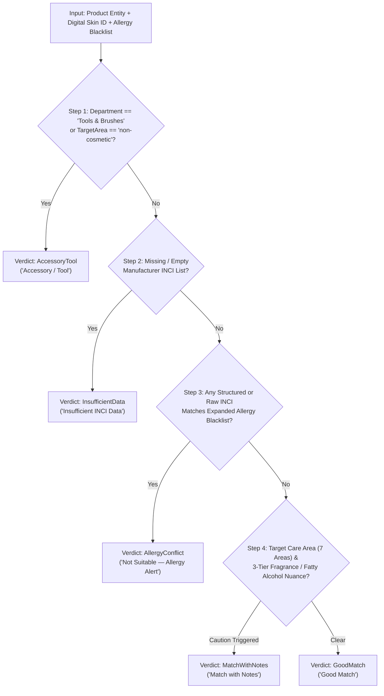
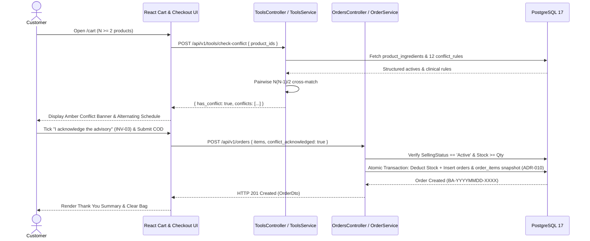
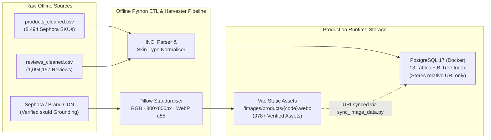

# CHAPTER 6: DESIGN AND IMPLEMENTATION OF THE PRODUCT

## 6.1 Technical Design and Algorithmic Invariants

The software engineering design of BeautyAI translates the dermatological principles established in Chapter 2 and the Clean Architecture boundaries defined in Chapter 4 into deterministic, high-throughput runtime implementations.

### 6.1.1 The Deterministic Suitability Verdict Cascade

In strict compliance with **INV-01** (the absolute prohibition of universal numerical "Safety Scores" or percentage compatibility gauges), BeautyAI evaluates ingredient compatibility via a deterministic, rule-based cascade implemented in `SuitabilityScoreCalculator.cs` and `CosmeticKnowledgeBase.cs`.


*Figure 6.1: Deterministic Suitability Verdict Cascade (`SuitabilityScoreCalculator.cs`, INV-01).*

The cascade executes across five ordered gates:
1. **Non-Cosmetic Tool Short-Circuit:** Physical tools (`Tools & Brushes`) bypass chemical parsing and return `AccessoryTool` (`"Accessory / Tool"`), remaining visible under *"Safe For My Skin"*.
2. **INCI Completeness Gate:** Cosmetic items lacking manufacturer INCI disclosures (`ingredient_list_raw` empty or `"No ingredients listed"`) return `InsufficientData` (`"Insufficient INCI Data"`) and are automatically excluded when *"Safe For My Skin"* is enabled.
3. **Zero-Tolerance Allergy Exclusion:** Both structured `product_ingredients` and tokenised `ingredient_list_raw` strings are cross-checked against the user's synonym-expanded Allergy Blacklist (`CosmeticKnowledgeBase.MatchAllergenInToken`). Any match immediately terminates with `AllergyConflict` (`"Not Suitable — Allergy Alert"`).
4. **Target Care Area & 3-Tier Fragrance/Fatty-Alcohol Nuance:** Across 7 resolved care areas (`Face`, `Eye Area`, `Lips`, `Hair & Scalp`, `Bath & Body`, `Fragrance`, `Nails & Cuticles`), the engine distinguishes soothing botanical extracts (`Rosa Damascena Flower Water`, `Vanilla`, `Chamomile`) and moisturising fatty alcohols (`Cetearyl Alcohol`, `Cetyl Alcohol`, `Stearyl Alcohol`) from drying denatured alcohols and the 26 EU fragrance allergens—returning `MatchWithNotes` with specific clinical guidance only when biologically warranted.
5. **Optimal Compatibility Baseline:** Products clearing all checks aligned with the user's skin profile return `GoodMatch`.

### 6.1.2 Smart Conflict Detector & Atomic COD Checkout Workflow

Unguided layering of potent clinical actives is mitigated through `ToolsService.CheckCartConflictsAsync`, seamlessly integrated with atomic Cash on Delivery (COD) checkout (`OrdersController` / `OrderService`). For a shopping bag containing $N$ products ($N \ge 2$), the engine evaluates all $\frac{N(N-1)}{2}$ unique product pairs against the 12 curated dermatological rules persisted in `conflict_rules`:
- **Evidence-Proportional Classification:** Matches are classified by severity (`Warning` or `Contraindication`) with scientific rationale and actionable alternating schedules.
- **Non-Blocking Advisory Model (`INV-03`):** Detected conflicts render a prominent amber warning panel in `/cart` requiring explicit acknowledgement (`conflict_acknowledged`) without blocking customer checkout autonomy.
- **Immutable Order Snapshot (`ADR-010`):** Upon order confirmation, `OrderService` atomically verifies stock, deducts quantities, and persists unit price snapshots into `order_items` so subsequent Admin price edits never alter historical orders.


*Figure 6.2: End-to-End Sequence Diagram for Smart Conflict Detection and Atomic COD Checkout.*

### 6.1.3 Deferred Conversational AI Adapter Seam (Phase 2 Readiness)

Although a conversational LLM chatbot (`M12`) was formally deferred to Phase 2 to respect the four-week schedule and avoid deploying unverified medical dialogue, the Clean Architecture adapter seam (`IAiSkincareProvider` in `BeautyAI.Application` and isolated `BeautyAI.Infrastructure.Providers`) was preserved and guarded by `ProviderLibrariesOnlyInAdapterLayerTests`, enabling clean Phase 2 activation without modifying core domain or controller logic.

### 6.1.4 Administrative Security and Soft-Delete Lifecycle (ADR-014)

Administrative operations are consolidated inside `AdminController` and `AdminProductService`:
- **Role-Based Access Control:** `[Authorize(Roles = "Admin")]` decorates the entire `AdminController`, verified at compile/test time by `AdminAuthorizationTests`.
- **Environment-Driven Bootstrapping (`AdminBootstrapper`):** On application startup, `AdminBootstrapper` reads `ADMIN_EMAIL` and `ADMIN_PASSWORD` (minimum 8 characters) from environment variables, hashes the password via PBKDF2 HMAC-SHA256 (600,000 iterations + cryptographic salt), and upgrades legacy hashes automatically (`INV-08`).
- **Soft Delete & 1-Click Restore:** Direct SQL `DELETE` statements on `products` are prohibited to protect `order_items` (`ON DELETE RESTRICT`) and `reviews` integrity. `DELETE /api/v1/admin/products/{id}` transitions `selling_status` to `"Discontinued"`, immediately hiding the SKU from public catalog/PDP/similar queries and blocking new orders, while `PATCH /api/v1/admin/products/{id}/restore` restores it to `"Active"` with zero data loss.

---

## 6.2 UI/UX Implementation and Local High-Resolution Imagery Architecture

### 6.2.1 Design System Preservation (ADR-007)

The React 19 + TypeScript + Vite frontend inherits the validated warm editorial cosmetic design system from the UI/UX prototype, pairing clean serif display headings with legible sans-serif body typography, a warm ivory background (`#FAF8F5`), pure white surface cards, and clinical amber/red alert tokens. The entire Phase 1 interface operates consistently in English with USD (`$`) pricing (`INV-09`, `INV-10`).

### 6.2.2 Data Ingestion & Local High-Resolution WebP Imagery ETL Pipeline

Early data exploration of the Kaggle Sephora dataset revealed that source CSVs lacked image URLs and SKU identifiers; naive heuristic scraping caused severe product-image mismatches and broken third-party CDN links, while storing binary/Base64 images inside PostgreSQL was rejected as a performance anti-pattern. BeautyAI resolves this through an automated offline ETL & **BeautyAI Harvester Protocol**:
1. **Relational Catalog & Big-Data Review ETL:** Python ingestion scripts normalise `products_cleaned.csv` (`8,494` SKUs), parse comma-delimited INCI strings into `ingredients` and `product_ingredients`, seed `12` clinical `conflict_rules`, and bulk-stream `1,094,197` reviews from `reviews_cleaned.csv` into PostgreSQL 17 with composite B-Tree indexing (`idx_reviews_product_skin`).
2. **SKU-Grounded Image Harvesting:** Grounding exact Sephora SKU IDs (`skuId`) and fetching zoom-resolution studio assets (`https://www.sephora.com/productimages/sku/{sku}-main-zoom.jpg`, with brand CDN fallback for EU exclusives).
3. **Pillow WebP Normalisation & Static URI Serving:** Converting assets to `800×800px` RGB WebP (quality 85, ~15–40 KB per asset) stored locally at `src/frontend/public/images/products/{code}.webp` (**378+ verified high-resolution product images**), while PostgreSQL stores exclusively the lightweight relative URI (`/images/products/{code}.webp`).


*Figure 6.3: Offline Data Ingestion and Local High-Resolution WebP Imagery ETL Pipeline.*

---

## 6.3 Implementation Sprints (Playbook Execution)

Development progressed across four weekly sprints inside isolated Git worktrees, each closed with an atomic State Snapshot:
- **Sprint 1 (Days 1–7):** Provisioned PostgreSQL 17 Docker container and `schema_phase_1.sql`; ingested 8,494 Sephora products, 12 conflict rules, and 1.09M reviews; built PBKDF2 + JWT authentication and unified Digital Skin ID endpoints.
- **Sprint 2 (Days 8–15):** Integrated the React 19 SPA; built the catalog query engine, *"Safe For My Skin"* filter, 3-Tier INCI PDP, text `Suitability Verdict`, standalone 7-area INCI Analyzer (`Blurred Preview Gate` + `SkinIdQuickModal`), and Wishlist.
- **Sprint 3 (Days 16–22):** Delivered persistent Cart & `CartDrawer`, pairwise Smart Conflict Detector, COD Checkout (`BA-YYYYMMDD-XXXX`), order history, and sub-20ms skin-type review filtering over 1.09M rows via composite B-Tree indexes.
- **Sprint 4 (Days 23–28):** Delivered the AM/PM Routine Generator with 1-Click *"Routine-to-Cart"* and `saved_routines` persistence, plus the 3-tab Admin Console (`Product Catalog CRUD`, `COD Orders`, `Analytics & Charts` over 100% live PostgreSQL data), formally scoping the conversational AI chatbot (`M12`) to Phase 2 while preserving the `IAiSkincareProvider` seam; culminated in 12/12 Architecture Tests and 46/46 Unit Tests passing.

---

## 6.4 Continuous Documentation & Refactoring Case Study: `CHANGE-ANALYZER-CATEGORY`

A defining strength of the AI-Agent Document-Driven SDLC was demonstrated during Sprint 2 through **`CHANGE-ANALYZER-CATEGORY`**:
1. **Defect & Invariant Breach Discovery:** Auditing the Sephora dataset revealed **890 cosmetic products lacking manufacturer INCI disclosures**, alongside non-cosmetic tools (`Tools & Brushes`) being misclassified by chemical analyzers. Concurrently, reflection auditing discovered that an earlier experimental DTO could potentially smuggle a forbidden JSON alias (`[JsonPropertyName("safety_score")]`) past a naive C# property-name check.
2. **Specification-First Resolution:** Before editing production code, a formal change folder (`docs/_changes/CHANGE-ANALYZER-CATEGORY/`) was opened to update requirements and design contracts: introducing the 3-group classification (`AccessoryTool`, `InsufficientData`, and 7-area chemical analysis) and expanding `INV-01` to inspect JSON serialisation attributes.
3. **Architecture Test Hardening & Worktree Verification:** `NoSafetyScoreAnywhereTests.cs` was hardened to reflectively inspect `[JsonPropertyNameAttribute]` across every property in every compiled assembly (Listing 6.1). Only after tests failed red and passed green inside an isolated worktree was the change merged alongside `state_2026-10-30_analyzer-category-redesign.md`.

---

## 6.5 Major Product Screenshots

> *[Note for Final Word Assembly: Capture the 6 high-resolution screenshots below from the live Docker/Vite instance at `http://localhost:5173` and insert them at the corresponding figure placeholders.]*

- **`[Figure 6.4: Product Catalog Page (/products) with Active "Safe For My Skin" Zero-Allergen Filter Toggle, USD ($) Pricing, and Text Suitability Verdict Badges]`**
- **`[Figure 6.5: Product Detail Page (/products/:id) Displaying 800×800 WebP Imagery, 3-Tier INCI Progressive Disclosure, Red Allergy Alert Banner, and 1.09M Reviews Filtered by Skin Type]`**
- **`[Figure 6.6: 30-Second Digital Skin ID Quick Configuration Modal (SkinIdQuickModal) Following Dermatology Order: Skin Type → Allergy Blacklist → Concerns & Budget]`**
- **`[Figure 6.7: Standalone INCI Analyzer (/ingredient-analyzer) Displaying 7 Target Care Areas, Blurred Preview Gate for Guests, and 3-Tier Formula Breakdown]`**
- **`[Figure 6.8: Shopping Cart (/cart) Displaying Non-Blocking Smart Conflict Detector Amber Warning Card with Alternating AM/PM Scheduling Advice and Acknowledgement Checkbox]`**
- **`[Figure 6.9: Admin Console (/admin) Showing Real-Time PostgreSQL KPIs, Product Catalog CRUD Table, ProductFormModal, and Soft-Delete (Discontinued) / 1-Click Restore Controls]`**

---

## 6.6 Key Code Implementations and Complete API Catalog

### 6.6.1 Core Source Code Listings (Extracted Directly from Production Codebase)

**Listing 6.1: Machine-Enforcing Invariant INV-01 Across Types, Properties, and JSON Attributes (`tests/BeautyAI.ArchitectureTests/NoSafetyScoreAnywhereTests.cs`)**

```csharp
private static readonly string[] ForbiddenTerms = new[]
{
    "SafetyScore", "safety_score", "SafetyRating", "safety_rating",
    "HazardScore", "hazard_score", "DangerLevel", "ToxicityScore", "SafetyLevel"
};

[Fact]
public void Assemblies_MustNotContainForbiddenSafetyScoreTerms()
{
    var assemblies = ArchitectureTestHelper.GetAllSolutionAssemblies();
    var violations = new List<string>();

    foreach (var assembly in assemblies)
    {
        foreach (var type in assembly.GetTypes())
        {
            var properties = type.GetProperties(
                BindingFlags.Public | BindingFlags.NonPublic |
                BindingFlags.Instance | BindingFlags.Static | BindingFlags.DeclaredOnly);

            foreach (var prop in properties)
            {
                var jsonAttr = prop.GetCustomAttribute<JsonPropertyNameAttribute>();
                foreach (var term in ForbiddenTerms)
                {
                    if (prop.Name.Contains(term, StringComparison.OrdinalIgnoreCase))
                        violations.Add($"Property: {type.FullName}.{prop.Name} violates INV-01.");

                    if (jsonAttr != null && jsonAttr.Name.Contains(term, StringComparison.OrdinalIgnoreCase))
                        violations.Add($"JsonPropertyName '{jsonAttr.Name}' on {type.FullName}.{prop.Name} violates INV-01.");
                }
            }
        }
    }

    Assert.True(violations.Count == 0, string.Join(Environment.NewLine, violations));
}
```

**Listing 6.2: Deterministic Suitability Verdict Cascade (`src/BeautyAI.Domain/Services/SuitabilityScoreCalculator.cs`)**

```csharp
public static SuitabilityVerdictResult Calculate(
    Product product, SkinProfile? skinProfile, IEnumerable<string>? allergyBlacklist)
{
    var department = product.Department ?? "Skincare";
    var targetArea = CosmeticKnowledgeBase.ResolveTargetArea(department, product.Category?.Name ?? "");

    // 1. Group A: Non-cosmetic Tools & Accessories
    if (string.Equals(department, "Tools & Brushes", StringComparison.OrdinalIgnoreCase) || targetArea == "non-cosmetic")
        return new SuitabilityVerdictResult("AccessoryTool", "Accessory / Tool", false,
            MatchReason: "Physical beauty tool or accessory — contains no chemical cosmetic ingredients.",
            HasIngredients: false, IsNonCosmeticTool: true);

    // 2. Group B: Cosmetic product missing manufacturer INCI list
    var rawInci = (product.IngredientListRaw ?? "").Trim();
    var hasStructured = product.ProductIngredients?.Count > 0;
    var hasRaw = !string.IsNullOrWhiteSpace(rawInci) && rawInci.Length >= 3 &&
                 !string.Equals(rawInci, "No ingredients listed", StringComparison.OrdinalIgnoreCase);
    if (!hasRaw && !hasStructured)
        return new SuitabilityVerdictResult("InsufficientData", "Insufficient INCI Data", false,
            MatchReason: "Manufacturer has not provided a detailed INCI list for this product.",
            HasIngredients: false, IsNonCosmeticTool: false);

    // 3. Zero-Allergy Check against synonym-expanded personal Allergy Blacklist
    if (allergyBlacklist != null && product.ProductIngredients != null)
    {
        foreach (var pi in product.ProductIngredients)
        {
            var match = CosmeticKnowledgeBase.MatchAllergenInToken(pi.Ingredient?.InciName ?? "", allergyBlacklist);
            if (match != null)
                return new SuitabilityVerdictResult("AllergyConflict", "Not Suitable — Allergy Alert", true,
                    MatchedAllergen: match,
                    MatchReason: $"Contains {match}, which matches your personal Allergy Blacklist.");
        }
    }
    // ... evaluates 7 target care areas, fragrance/fatty-alcohol nuance -> MatchWithNotes or GoodMatch
}
```

**Listing 6.3: Zero-Allergen "Safe For My Skin" Catalog Query (`src/BeautyAI.Infrastructure/Persistence/Repositories/ProductRepository.cs`)**

```csharp
var query = _context.Products
    .Include(p => p.Brand)
    .Include(p => p.Category).ThenInclude(c => c!.Parent)
    .Where(p => p.SellingStatus == "Active")
    .AsNoTracking();

if (filter.SafeForMe || allergyBlacklist != null)
{
    // Exclude Group B cosmetics lacking INCI data while retaining Group A Tools & Brushes
    query = query.Where(p =>
        p.Department == "Tools & Brushes" ||
        (!string.IsNullOrEmpty(p.IngredientListRaw) && p.IngredientListRaw != "No ingredients listed"));

    var allergens = CosmeticKnowledgeBase.ExpandAllergyBlacklist(allergyBlacklist)
        .Select(a => a.ToLower()).Distinct().ToList();

    if (allergens.Count > 0)
    {
        query = query.Where(p => !p.ProductIngredients.Any(pi =>
            pi.Ingredient != null && allergens.Contains(pi.Ingredient.InciName.ToLower())));

        foreach (var allergen in allergens)
            query = query.Where(p => !p.IngredientListRaw.ToLower().Contains(allergen));
    }
}
```

**Listing 6.4: Pairwise Active-Ingredient Conflict Detection (`src/BeautyAI.Application/Services/ToolsService.cs`)**

```csharp
public async Task<ConflictCheckResponse> CheckCartConflictsAsync(
    ConflictCheckRequest request, CancellationToken cancellationToken = default)
{
    if (request.ProductIds == null || request.ProductIds.Count < 2)
        return new ConflictCheckResponse(false, Array.Empty<ConflictDetailDto>());

    var products = await _toolRepository.GetProductsForConflictCheckAsync(request.ProductIds, cancellationToken);
    var conflictRules = await _toolRepository.GetAllConflictRulesAsync(cancellationToken);
    var detected = new List<ConflictDetailDto>();

    for (int i = 0; i < products.Count; i++)
    {
        for (int j = i + 1; j < products.Count; j++)
        {
            // Cross-match product i and product j actives against curated conflict_rules
            var p1 = products[i];
            var p2 = products[j];
            // Emits non-blocking ConflictDetailDto (Severity, Reason, Alternating Recommendation)
        }
    }
    return new ConflictCheckResponse(detected.Count > 0, detected);
}
```

**Listing 6.5: Administrative Soft Delete & 1-Click Restore (`src/BeautyAI.Application/Services/AdminProductService.cs`)**

```csharp
public async Task<bool> DiscontinueProductAsync(int id, CancellationToken cancellationToken = default)
{
    var existing = await _productRepository.GetAdminProductByIdAsync(id, cancellationToken);
    if (existing == null) return false;

    existing.SellingStatus = "Discontinued"; // Preserves historical reviews & order_items (ADR-014)
    existing.UpdatedAtUtc = DateTime.UtcNow;
    await _productRepository.UpdateProductAsync(existing, cancellationToken);
    return true;
}

public async Task<AdminProductDto> RestoreProductAsync(int id, CancellationToken cancellationToken = default)
{
    var existing = await _productRepository.GetAdminProductByIdAsync(id, cancellationToken)
        ?? throw new KeyNotFoundException($"Product with ID {id} not found.");

    existing.SellingStatus = "Active";
    existing.UpdatedAtUtc = DateTime.UtcNow;
    var updated = await _productRepository.UpdateProductAsync(existing, cancellationToken);
    var (rating, count) = await _productRepository.GetProductReviewStatsAsync(updated.Id, cancellationToken);
    return MapToDto(updated, rating, count);
}
```

### 6.6.2 Complete Implemented REST API Endpoint Catalog

**Table 6.1: Complete Catalog of 28 Active Phase 1 REST API Endpoints Across 8 Core Controllers**

| Controller | Method | Endpoint URI | Authorisation | Business Purpose |
|---|---|---|---|---|
| `AuthController` | `POST` | `/api/v1/auth/register` | Anonymous | Register customer account (PBKDF2 600k rounds) & issue JWT. |
| | `POST` | `/api/v1/auth/login` | Anonymous | Authenticate credentials & issue JWT token. |
| | `GET` | `/api/v1/auth/me` | Authenticated | Retrieve current user profile & unified Digital Skin ID. |
| | `PUT` | `/api/v1/auth/profile` | Authenticated | Update full name, phone number, and default shipping address. |
| `SkinProfileController` | `GET` | `/api/v1/skin-profile` | Authenticated | Retrieve unified Digital Skin ID & personal Allergy Blacklist. |
| | `PUT` | `/api/v1/skin-profile` | Authenticated | Atomically update skin type, allergies, concerns, goal & budget. |
| | `POST` | `/api/v1/skin-profile/allergies` | Authenticated | Add an allergen to personal Allergy Blacklist with symptom note. |
| | `DELETE` | `/api/v1/skin-profile/allergies/{id}` | Authenticated | Remove an allergen from personal Allergy Blacklist. |
| `ProductsController` | `GET` | `/api/v1/products` | Anonymous / Auth | Paginated catalog search, filters & *"Safe For My Skin"* toggle. |
| | `GET` | `/api/v1/products/{id}` | Anonymous / Auth | Product detail (by ID/Slug/Code), 3-Tier INCI & `SuitabilityVerdict`. |
| | `GET` | `/api/v1/products/{id}/similar` | Anonymous / Auth | Similar category recommendations (excluding user allergens). |
| | `GET` | `/api/v1/products/categories` | Anonymous | Retrieve product category taxonomy list. |
| | `GET` | `/api/v1/products/brands` | Anonymous | Retrieve verified cosmetic brand list. |
| | `GET` | `/api/v1/products/{id}/reviews` | Anonymous | Sub-15ms paginated review query filtered by `skin_type`. |
| | `POST` | `/api/v1/products/{id}/reviews` | Anonymous / Auth | Submit a new product review with skin-type tag. |
| `ReviewsController` | `POST` | `/api/v1/reviews` | Anonymous / Auth | Compatibility review submission endpoint. |
| `ToolsController` | `POST` | `/api/v1/tools/analyze-inci` | Authenticated | 3-Tier INCI formula analysis across 7 target care areas. |
| | `GET` | `/api/v1/tools/skintype-guide` | Authenticated | Skin-type ingredient guide by target care area. |
| | `POST` | `/api/v1/tools/check-conflict` | Anonymous | Pairwise active-ingredient conflict scan across cart items. |
| `RoutinesController` | `POST` | `/api/v1/routines/generate` | Anonymous / Auth | Generate allergen-free, conflict-free AM/PM routine. |
| | `POST` | `/api/v1/routines/save` | Authenticated | Save generated routine to `saved_routines`. |
| | `GET` | `/api/v1/routines/my-routines` | Authenticated | List user's saved skincare routines. |
| | `DELETE` | `/api/v1/routines/{id}` | Authenticated | Delete a saved routine. |
| `OrdersController` | `POST` | `/api/v1/orders` | Authenticated | Place atomic COD order (`BA-YYYYMMDD-XXXX`) & deduct stock. |
| | `GET` | `/api/v1/orders/my-orders` | Authenticated | Retrieve customer's COD order history. |
| `AdminController` | `GET` | `/api/v1/admin/dashboard` & `/kpis` | `Admin` Role | Real-time KPIs & analytics across 8,494 products & 1.09M reviews. |
| | `GET` / `GET {id}` | `/api/v1/admin/products[/{id}]` | `Admin` Role | Search, filter (`Active`/`Draft`/`Discontinued`) & inspect products. |
| | `POST` / `PUT` / `DELETE` / `PATCH` | `/api/v1/admin/products[/{id}][/restore]` & `/orders[/{id}/status]` | `Admin` Role | Full Product CRUD + INCI sync + Soft Delete + 1-Click Restore + COD Order Status management. |
