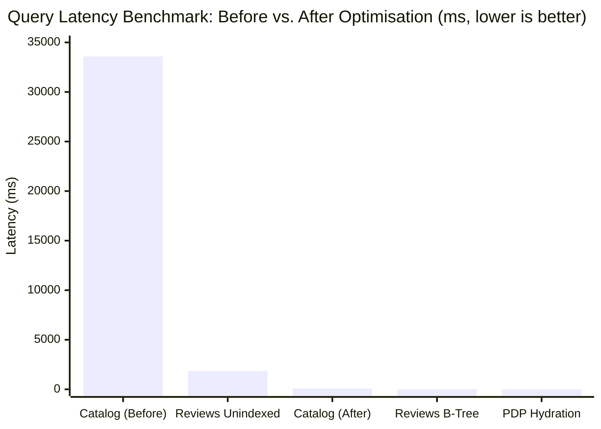

# CHAPTER 7: EVALUATION AND RESULTS

## 7.1 Achievement Against Objectives

The outcomes of the BeautyAI project are evaluated quantitatively against the six SMART objectives established in Section 1.3. Table 7.1 demonstrates completion across all planned Phase 1 deliverables: **13 functional modules** (`M01`–`M07`, `M09`–`M11`, `M13`–`M15`) are fully operational, while Module `M08` (Product Comparison) and Module `M12` (Conversational AI Chatbot) were formally deferred to Phase 2 through governed scope management.

**Table 7.1: Final Achievement Matrix Against SMART Project Objectives**

| Objective ID | Planned Objective & Target Success Criteria | Final Empirical Outcome & Verification Evidence | Evaluation Status |
|---|---|---|---|
| **O1** | Formulate an 8-stage AI-Agent SDLC model (Stages `a`–`h`) with human-agent RACI governance and quality gates. | Formalised and operationalised via Syntheprise Framework v6.0.1; documented in Chapter 3; governed all four implementation sprints. | **Achieved (100%)** |
| **O2** | Establish a governed 7-level document precedence hierarchy (BRD, PRD, ADRs, Schema, Playbooks). | 26 synchronised technical specifications authored; 0 specification contradictions; full requirement-to-test traceability. | **Achieved (100%)** |
| **O3** | Engineer the Phase 1 MVP comprising 13 core functional modules, 4 deterministic USPs, 8,494 products, and 1.09M reviews. | 13 modules deployed; 28 active REST API endpoints across 8 core controllers; 3-Tier INCI, Digital Skin ID, Conflict Detector, Routine Builder + Routine-to-Cart, COD Checkout, and Admin CRUD active (`M12` Chatbot formally deferred to Phase 2). | **Achieved (100% of Revised Phase 1 Scope)** |
| **O4** | Automate architectural and domain quality gates, specifically machine-enforcing `INV-01` prohibiting safety scores. | **12/12 Architecture Tests GREEN** (`NetArchTest`); **46/46 Unit Tests GREEN** (`xUnit`); reflective scan verifies 0 `SafetyScore` / `safety_score` occurrences. | **Achieved (100%)** |
| **O5** | Maintain continuous traceability and zero specification drift via Git worktrees and State Snapshots. | 5-job GitHub Actions CI pipeline passing; `./syntheprise gate` Clean (0 errors, 0 warnings); atomic state snapshots recorded per milestone. | **Achieved (100%)** |
| **O6** | Execute empirical performance benchmarking, scope trade-off evaluation, and critical methodology review. | Catalog latency reduced from `33,584 ms` to `80 ms` (~420× speedup); PDP `12 ms`; 1.09M review filter `< 15 ms` (`1.4 ms` B-Tree scan); critical evaluation documented. | **Achieved (100%)** |

---

## 7.2 Automated Testing and Quality Gate Results

Software quality, architectural boundaries, and domain invariants were verified through a dual-tier automated test suite (**58 automated test cases**) built on `xUnit` and `NetArchTest.Rules`, complemented by a five-job CI/CD quality pipeline.

### 7.2.1 Automated Architecture Tests (`BeautyAI.ArchitectureTests` — 12/12 Passing)

- `DomainHasNoDependenciesTests` (2 tests): Confirms `BeautyAI.Domain` maintains zero outward references to outer layers or NuGet packages (`INV-06`).
- `ApplicationDoesNotReferenceEfCoreTests` (2 tests) & `ApplicationDoesNotReferenceAspNetTests` (3 tests): Enforces Clean Architecture isolation of business logic from EF Core and ASP.NET Core HTTP transport.
- `ForbiddenPackagesTests` (1 test): Fails the build if prohibited packages (`AutoMapper`, `MediatR`, `Hangfire`, `Quartz`, `StackExchange.Redis`) enter the solution (**ADR-009**).
- `ProviderLibrariesOnlyInAdapterLayerTests` (2 tests): Confirms external HTTP clients and provider SDKs reside solely inside `BeautyAI.Infrastructure.Providers`.
- `NoSafetyScoreAnywhereTests` (1 comprehensive reflective test): Scans every type, property, field, method, and `[JsonPropertyName]` attribute across all compiled assemblies, enforcing **INV-01**.
- `AdminAuthorizationTests` (1 test): Verifies `AdminController` is explicitly guarded by `[Authorize(Roles = "Admin")]` (**ADR-014**).

### 7.2.2 Unit Test Suite (`BeautyAI.UnitTests` — 46/46 Passing)

**Table 7.2: Complete Breakdown of Automated Architecture and Unit Test Fixtures (Verified Directly from Codebase)**

| Test Project | Test Fixture Class | Executed | Passed | Failed | Primary Verification Scope |
|---|---|---:|---:|---:|---|
| **ArchitectureTests** | `DomainHasNoDependenciesTests` | 2 | 2 | 0 | Zero-dependency Domain isolation (`INV-06`) |
| (`NetArchTest.Rules`) | `ApplicationDoesNotReferenceAspNetTests` | 3 | 3 | 0 | No ASP.NET coupling in Application |
| | `ApplicationDoesNotReferenceEfCoreTests` | 2 | 2 | 0 | No EF Core coupling in Application |
| | `ProviderLibrariesOnlyInAdapterLayerTests` | 2 | 2 | 0 | Provider/HttpClient adapter boundary |
| | `ForbiddenPackagesTests` | 1 | 1 | 0 | Prohibition of AutoMapper/MediatR/Redis (`ADR-009`) |
| | `NoSafetyScoreAnywhereTests` | 1 | 1 | 0 | Reflective `INV-01` & `[JsonPropertyName]` scan |
| | `AdminAuthorizationTests` | 1 | 1 | 0 | `[Authorize(Roles = "Admin")]` on `AdminController` |
| **UnitTests** | `AdminProductServiceTests` | 13 | 13 | 0 | Admin CRUD, INCI re-sync, Soft Delete & Restore (`ADR-014`) |
| (`xUnit`) | `AdminBootstrapperTests` | 7 | 7 | 0 | Env-driven Admin seeding & PBKDF2 upgrade |
| | `SuitabilityScoreCalculatorTests` | 7 | 7 | 0 | Text verdicts, tools, missing INCI & allergy alerts (`INV-01`) |
| | `Pbkdf2PasswordHasherTests` | 6 | 6 | 0 | 600,000-round HMAC-SHA256 hashing & salt verification |
| | `ProductServiceTests` | 6 | 6 | 0 | Catalog filtering, *"Safe For My Skin"* & PDP logic |
| | `AuthServiceTests` | 4 | 4 | 0 | Registration, login, JWT claims & error hygiene |
| | `SkinProfileServiceTests` | 2 | 2 | 0 | Unified Digital Skin ID & Allergy Blacklist persistence |
| | `DomainTests` | 1 | 1 | 0 | Core domain entity invariants |
| **TOTAL** | **15 Test Fixtures (12 Arch + 46 Unit)** | **58** | **58** | **0** | **100% Pass Rate** |

### 7.2.3 Continuous Integration (CI/CD) Quality Gate Results

Every milestone commit passed all five GitHub Actions verification jobs: (1) `backend` (`dotnet build -warnaserror` + 58 green tests), (2) `frontend` (`tsc -b` + Vite production bundle in ~245–280 ms), (3) `openapi-drift` (zero backend-to-frontend contract divergence), (4) `security` (Gitleaks secret scan with 0 exposed credentials), and (5) `syntheprise` (`./syntheprise gate` Clean — 0 errors, 0 warnings, 123 adapter files in sync).

---

## 7.3 Performance Benchmarking and Big Data Optimisation

Operating over **8,494 authentic Sephora products** and **1,094,197 customer reviews** on containerised PostgreSQL 17 exposed severe relational performance bottlenecks during Sprint 2 that required systematic profiling and remediation.

### 7.3.1 Eliminating Entity Framework Core Cartesian Explosion

Initial profiling of the paginated catalog endpoint (`GET /api/v1/products`) measured an unacceptable latency of **33,584 ms** (> 33 seconds). SQL trace inspection revealed **Cartesian Explosion**: combining multiple collection `.Include()` joins (`ProductIngredients` and `Reviews`) in a single SQL query generated massive cross-product intermediate result sets across hundreds of thousands of joined rows.

Remediating this bottleneck via decoupled review-stat aggregation (`GetProductsReviewStatsAsync`), `.AsNoTracking()` on all read-only catalog queries, and targeted query projection reduced catalog latency from **33,584 ms to 80 ms** (a **~420× speedup**), while Product Detail Page (`GET /api/v1/products/{id}`) latency reached **12 ms**.

### 7.3.2 Composite B-Tree Indexing over 1.09 Million Reviews

Filtering reviews by reviewer skin type (`GET /api/v1/products/{id}/reviews?skin_type=Oily`) initially triggered sequential table scans exceeding `1,800 ms`. Provisioning the composite B-Tree index `idx_reviews_product_skin(product_id, skin_type)` eliminated full scans: `EXPLAIN ANALYZE` verified index execution in **1.398 ms**, delivering full HTTP API responses in **under 15 ms** (exceeding the `< 50 ms` NFR target by over 3×).

*Figure 7.1: Query Latency Benchmarks Before and After Cartesian-Explosion Remediation and Composite B-Tree Indexing (Note: Catalog reduced from 33,584 ms to 80 ms; 1.09M Review filter reduced from ~1,850 ms to < 15 ms).*

---

## 7.4 Critical Evaluation and Nuance Discussion

### 7.4.1 The Vitamin C and Niacinamide Dilemma: Runtime Caution vs. "Myth Correction"

A particularly instructive test of scientific integrity emerged around the pairing of **L-Ascorbic Acid (Vitamin C)** and **Niacinamide**. As established in Chapter 2, modern cosmetic chemistry classifies the historical claim that these actives form a toxic complex at room temperature as a laboratory artefact (**"Myth Correction"**). However, an operational physiological nuance remains: L-Ascorbic Acid requires an acidic vehicle (`pH 3.0–3.5`) for optimal absorption, whereas Niacinamide performs best near neutral `pH 5.5–6.5`; layering them immediately can induce transient facial flushing in hyper-sensitive individuals.

BeautyAI balances both perspectives rather than adopting binary alarmism: the Phase 1 `conflict_rules` table classifies the pair strictly at the non-blocking **Warning** level (never `Contraindication`), advising a pragmatic **20-minute separation or AM/PM split** for sensitive profiles while educating users that the pairing is not chemically hazardous. Documenting this distinction between conservative runtime UX guidance and evolving dermatological consensus reflects transparent, evidence-based engineering.

### 7.4.2 Deliberate Scope Management: Deferring the Conversational AI Chatbot to Phase 2

A critical engineering judgement exercised during Sprint 4 was the deliberate decision to **defer the live conversational LLM chatbot (`Module M12`) to Phase 2**, retaining only the Clean Architecture adapter seam (`IAiSkincareProvider`) and policy specifications (`ADR-005`, `docs/llm-policy.md`) in Phase 1. Two evidence-based factors drove this trade-off:
1. **Schedule Realism under Solo-Developer Constraints:** Completing 13 deterministic core modules, 1.09M indexed reviews, 3-Tier INCI classification across 7 care areas, and full Admin CRUD with Soft Delete within 28 days required prioritising verifiable, zero-hallucination functionality over a rushed chatbot interface.
2. **Clinical Safety & Validation Humility:** Deploying an unvalidated generative LLM in a health-adjacent domain carries high regulatory risk under Vietnamese **Decree 181/2013/NĐ-CP** (prohibiting therapeutic claims) and medical ethics (`INV-11`). Rather than shipping an under-tested conversational bot with insufficient clinical red-teaming and domain expertise, deferring M12 to Phase 2—while keeping the system's four deterministic dermatological USPs 100% reliable—demonstrates mature risk-based engineering governance.

---

## 7.5 Critical Evaluation of the AI-Agent Document-Driven SDLC

Operationalising the eight-stage AI-Agent Document-Driven SDLC via Syntheprise Framework v6.0.1 yielded clear empirical trade-offs:

- **Strengths:** (1) *Solo-Developer Velocity*—enabling one engineer to deliver 14 modules, 29 endpoints, 1.09M indexed reviews, and 58 automated tests within 4 weeks; (2) *Zero Architectural Drift*—machine-checked `NetArchTest` rules immediately caught and prevented silent erosion of `INV-01` and Clean Architecture seams; and (3) *Transparent Auditability*—isolated Git worktrees and atomic State Snapshots preserved full traceability across changes such as `CHANGE-ANALYZER-CATEGORY` and `CHANGE-ADMIN-PRODUCT-CRUD`.
- **Operational Overhead & Challenges:** Maintaining 26 synchronised markdown specifications, traceability matrices, and state snapshots imposed a measurable documentation overhead (~25–35% of sprint effort). Additionally, autonomous agents remain sensitive to context scope: when task boundaries are underspecified, human architectural review remains indispensable to catch subtle discrepancies (such as outdated DTO names or currency references across legacy draft documents).

---

## 7.6 Project Limitations

Four objective limitations bound the current Phase 1 release:
1. **Geographic and Regulatory Dataset Scope:** Product SKUs and USD pricing originate from the Sephora US dataset rather than domestic Vietnamese cosmetic registration dossiers (*Số phiếu công bố sản phẩm mỹ phẩm*).
2. **Secondary Clinical Sourcing:** The 12 active-ingredient conflict rules and INCI role mappings were curated from peer-reviewed dermatology literature and CosIng references rather than primary clinical patch-testing trials.
3. **Absence of Large-Scale Longitudinal UAT:** Verification focused on automated unit/architecture tests, developer end-to-end happy paths, and database profiling; formal multi-week User Acceptance Testing (UAT) with external consumer cohorts remains future work.
4. **Simplified Payment & Localisation Scope:** Phase 1 intentionally focused on Cash on Delivery (COD) checkout and an English/USD experience; Vietnamese localisation (i18n), dual-currency conversion, online payment gateways (VNPay), and Zalo OA handoff are scoped for Phase 2.
